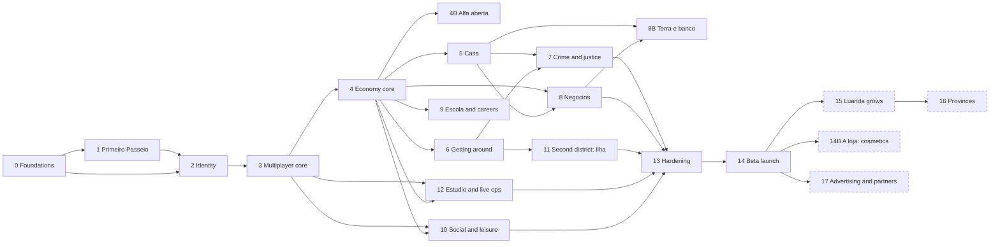

# NZILA · ANGOLA LIFE GAME ROADMAP (v1.0)
**Project:** Nzila *(working name)* · A multiplayer life game set in Angola, in the phone's browser, in Angolan Portuguese
**Strategy:** "A world, not a set of rooms. One city you can walk, one economy everyone shares, consequences that hold."
**Goal:** a phone-first, low-data, server-authoritative 3D world that starts with one slice of Luanda, grows district by district, then province by province, and only then turns on the business.

> **Tone rule (non-negotiable in player-facing copy):** never name or compare with another game.

**Companion docs:** `TO_START_EVERY_SESSION.md` (always-on context and rules) · `UX_UI_SPEC.md` (art direction, design system, every screen, data shapes) · `docs/reference/WORLD_ATLAS.md` (districts, provinces, wonders, pack format, expansion checklist). Read all together.

---

## EXECUTIVE SUMMARY

Nzila has seven surfaces:

- **The world:** the 3D city on the canvas. Streets, interiors, vehicles, water, other players, NPC life.
- **The HUD:** joystick, context action, wallet chip, compass, chat. Small, at the edges.
- **The Telemóvel:** the in-game phone. Every system is an app in it (Mapa, Mensagens, Banco, Biscatos, Casa, Garagem, Negócio, BI, Definições).
- **Interiors and minigames:** homes, shops, workplaces, the kitchen, the classroom, the pitch.
- **The front door:** the landing and loading flow that gets a guest into the world in under a minute and under 6 MB.
- **Estúdio:** the staff console for moderation, live operations, economy and pack publishing.
- **Parceiros (Phase 17):** advertisers and partner brands.

### Core rules
| Rule | Description |
|------|-------------|
| **Reference-Phone** | Done means measured on the reference phone: 30 fps, the draw and memory budgets, 100 ms input response. |
| **Megabytes-Are-Money** | First play under 6 MB, a district under 8 MB, under 10 MB an hour. Sizes shown before download. |
| **Server-Decides** | The client proposes, the zone decides with `packages/sim`, the API records. |
| **Ledger** | Every Makuta movement is a double-entry transfer. All accounts sum to zero. |
| **Idempotent-Actions** | Every mutation carries a client id and is safe to replay. |
| **Consequence-Without-Ruin** | Crime has real consequences for the offender and capped, recoverable loss for the victim. |
| **Heat-Not-Labels** | Risk is computed per block and hour. No place is labelled dangerous. |
| **No-Real-Brands** | No real company, person, party, church or state emblem without a signed agreement. |
| **Province-Is-Content** | A district or a province is a pack and a registry row, never an engine change. |
| **Angola-First Copy** | Portuguese of Angola from the catalog, reviewed by Angolans. |
| **Player-Safety** | Report, block and mute wherever people can talk. Age gate. No unmoderated voice or images. |
| **Weak-Network** | Playable at 250 ms and 5% loss. Reconnect in 60 seconds with nothing lost. |
| **Three-Minute** | Something that matters fits in three minutes. |
| **Tunables-In-Data** | Prices, wages, fares, sentences, caps and timers are data, edited in the Estúdio. |
| **No-Pay-To-Win** | Real money buys looks and convenience, never power. |
| **Privacy-First** | Minimum data, encrypted, self-service export and deletion, staff reads logged with a reason. |
| **Nothing-Before-It-Is-True** | No fake player counts, no bots posing as players. |

### The loop the game is built around
```
Arrive  →  Earn (biscato, career, business)  →  Spend (food, rent, transport, home, vehicle)
   ↑                                                        │
   │                                                        ↓
Explore (districts, provinces, wonders)  ←  Belong (kambas, turma, football, nights out)
                         ↑
        Risk (crime, police, justice) cuts across every step
```

---

## DEPENDENCY MAP

Every task declares `Depends on` and `Unblocks`. This is the phase-level view. A phase does not open until its gate is true.



**Critical path to beta:** 0 → 1 → 2 → 3 → 4 → 5 → 6 → 7 → 8 → 11 → 12 → 13 → 14. Phases 8B, 9 and 10 run in parallel once their gates open and are not required for beta; from Phase 10, only 10.1 (kambas) is required for beta.

**Real players before beta (D-0.28).** Phase 4B opens the game to anyone with the link as soon as there is something to do in it. It is not on the critical path as a blocker, but nothing after Phase 5 is started without reading its numbers: if players stay for the table game and the candongueiro and ignore the biscatos, the order of Phases 5 to 10 changes to follow them.

**Why the provinces sit after beta.** A game with one loved district and four hundred players in it is alive. A game with four provinces and four hundred players spread across them is empty. Every new place divides the crowd, so places are added when the crowd asks for them. The pack pipeline is proved before beta (Phase 11) so that adding places afterwards is routine work, not engineering.

**Where the money comes from (D-0.20, amended 2026-11-14).** The cosmetics shop opens right after beta (Phase 14B), because servers and moderators cost money from the first day of beta and the diaspora can pay by card. Advertising follows when there is attention to sell (Phase 17) and no longer waits for the provinces. There are no payouts to players: they would turn every exploit into theft of real money. The seams are built early (the ad slots in 8.7, the closed ledger in 0.3).

**Deliberate stubs allowed:**
- `S-1` the `LocalWorld` provider in Phase 1: the simulation runs in the browser with no server. Retired by 3.3.
- `S-2` placeholder art: greybox and permissively licensed kit models stand in for final art. Each pack records its art pass (0 greybox, 1 kit, 2 final). No district opens to the public below pass 2 on its landmarks. Retired per pack.
- `S-3` house ads: the ad slots built in 8.7 show the game's own posters until Phase 17.
- `S-4` NPC police only. A player police career is Phase 18.
- `S-5` one-time codes print to the console in development until the provider is chosen in 2.2.

**Seams kept open (build now, use later). Nothing may close them:**
1. `province_id` and `district_id` on every world-scoped row and message from Phase 0, though only one of each exists until Phase 11.
2. The ledger is one closed system with named system accounts, so the record of real-money purchases (Phase 14B) can sit beside it without touching it.
3. Every ad surface in the world is a named slot in the pack manifest from 8.7.
4. The renderer, the transport and the auth provider each sit behind one module.

---

## PHASE 0: FOUNDATIONS ✅ (complete 2026-11-14, `docs/completed/PHASE_0_COMPLETE.md`)
*Goal: a correct skeleton. The shared simulation, the economy rules, the protocol, the pack format, the tokens and the budgets exist and are tested before anything is drawn. Nothing player-facing ships except a styleguide route.*

**Dependency gate:** none. The founder has read D-0.1 to D-0.22 in `TO_START_EVERY_SESSION.md`.

### Task 0.1: Monorepo skeleton
- [x] pnpm workspaces + Turborepo; `apps/client` (Vite, TypeScript strict), `apps/zone`, `apps/api` (Fastify), `apps/worker`, `apps/studio`, the seven packages (the stack lists seven; "eight" was a miscount), `content/`, `art/` (Git LFS), `tools/`, `infra/`, `docs/`.
- [x] `infra/docker-compose.yml`: PostgreSQL, Redis, object storage (MinIO). `pnpm dev` brings up everything; `pnpm dev:client` runs the client alone. *(2026-11-14: the file validates; the services themselves have not been started yet.)*
- [x] CI: typecheck, lint, unit tests on every push; integration tests on disposable Postgres and Redis; the size budget check (0.9) from the first commit. *(2026-11-14: the workflow is written and every step passes locally; it has not run on a remote because there is no remote yet.)*
- [x] `CLAUDE.md` at the root; the "How to run it" paragraph in Current State.
- Depends on: none · Unblocks: every task.

### Task 0.2: `packages/sim` (the deterministic heart, zero deps)
- [x] Fixed-step world (20 Hz), seeded random, no `Date.now()` and no floating-point traps across engines (integer or fixed-point positions in millimetres). *(2026-11-14: positions in millimetres, angles in centidegrees, sine and arctangent from integer tables in `fixed.ts`. A lint rule fails the build on `Date`, `Math.random`, `Math.sin` and their kind inside the package.)*
- [x] `movement.ts`: kinematic character controller on a walk grid with slopes, steps and simple obstacle shapes. `vehicle.ts`: arcade model (bicycle, motorizada, car, van, boat, jet ski as parameter sets). `collision.ts`. *(2026-11-14: the ground is read through a `Ground` interface in `grid.ts`, so the chunk streaming of 1.2 can sit behind it. People do not block each other. Vehicle numbers are starting values, tuned on the road in Phase 6. Obstacles are scanned in a list; a spatial index is added when a district is dense enough to need one, measured by the swarm in 3.7.)*
- [x] `clock.ts`: the world clock (one game day is 60 real minutes: 40 day, 20 night; a tunable) shared by every channel. *(2026-11-14: the hour from 17:00 to 18:00 takes 10 of the 40 daylight minutes, so golden hour is a quarter of the day as `UX_UI_SPEC.md` §0 asks.)*
- [x] `route.ts`: position of a route vehicle as a pure function of route, schedule and clock. *(2026-11-14: routes are closed loops; vans ease away from and into each stop; a van finishes the lap it started before the service window closed; `msUntilArrival` answers the paragem's "next van in".)*
- [x] `needs.ts`, `heat.ts`, `offence.ts`, `minigame/*.ts` as typed stubs with their first golden tests; filled by Phases 4, 7 and 4.5.
- [x] 100% line coverage enforced. The same inputs give the same outputs in Node and in a browser (a test runs both). *(2026-11-14: lines, statements, branches and functions at 100%, enforced by `pnpm test`. `pnpm test:engines` runs the package's tests in Chromium, WebKit and Firefox against the same golden numbers as Node.)*
- Depends on: 0.1 · Unblocks: 1.3, 1.6, 3.1, 3.3, 4.4, 6.4, 7.1.

### Task 0.3: `packages/economy` (the rules of money, zero deps)
- [x] `ledger.ts`: transfer validation (positive integer amount, distinct accounts, sufficient funds unless the debit account is a system faucet), reversal, idempotency semantics. *(2026-11-14: also an in-memory `Book` that applies the same rules, for tests, simulations and the audit's arithmetic. A transfer is reversed at most once and a reversal is never reversed. A reversal fails when the Makuta has already been spent: recovering it is a decision for support, not arithmetic.)*
- [x] `accounts.ts`: account kinds (`player_cash`, `player_bank`, `business_till`, `escrow`, `system_faucet:<kind>`, `system_sink:<kind>`). *(2026-11-14: four named faucets and ten named sinks. Only a reversal may credit a faucet or debit a sink.)*
- [x] `tunables.ts`: the typed shape of the tunables file and its validator; a starter `tunables/base.json`. *(2026-11-14: one description gives both the type and the validator. The numbers fixed by Rule 6 and the HUD fare are in the file as written; starting cash, the transfer and stake caps, the assalto ceiling, the house cut, the needs rates and the heat weights are placeholders for the founder and the economy designer.)*
- [x] `health.ts`: faucet and sink totals, velocity and inflation as pure functions over a window of transfers. *(2026-11-14: inflation here is growth of the money supply; a price index joins it when there are prices, in 4.6.)*
- [x] 100% coverage. A property test proves that any sequence of valid transfers keeps the sum at zero. *(2026-11-14: 10 000 requests, valid and invalid, with replays and reversals; the sum is checked after every one, and no account but a faucet ever goes below zero.)*
- Depends on: 0.1 · Unblocks: 0.5, 4.1, 4.6, 8.5.

### Task 0.4: `packages/protocol`
- [x] Versioned binary schemas: `Input`, `Snapshot` (delta-compressed, area-of-interest filtered), `Event`, `Chat`, `Join`, `Handoff`. Encode and decode with round-trip tests and a size test per message (an on-foot snapshot for 30 visible avatars under 600 bytes). *(2026-11-14: 30 avatars sent whole are under 600 bytes; all 30 walking, as a delta, under 300; standing still, 10. An `Input` of four frames is 20 bytes. Decoders take any bytes and fail only with a `ProtocolError`. `Input` carries the stick only: each verb of `ActionIntent` (board, buy, enter and the rest) gets its own message in the task that builds the verb, which the type byte allows without a version change. Chat too far away to read is sent without its text.)*
- [x] Version negotiation: an old client is told to refresh, never crashes. *(2026-11-14: the layouts of `Join` and `JoinRefused` are frozen and pinned by golden bytes; a client skips a message type it does not know and ignores fields added to the end of one it does.)*
- Depends on: 0.1, 0.2 · Unblocks: 3.1, 3.3.

### Task 0.5: `packages/db` core schema
- [x] `players`, `player_sessions`, `devices`, `avatars`, `consents`, `staff`, `staff_roles`, `audit_log`, `feature_flags`, `provinces`, `districts`, `packs`. *(2026-11-14: `players` holds no personal data yet; the encrypted columns arrive with the tasks that need them (0.10, 2.2). `player_sessions` is ours for now and is reconciled with Better Auth's own tables in 2.1.)*
- [x] `ledger_accounts`, `ledger_transfers` (append-only trigger refuses UPDATE and DELETE), `balances` (derived cache). *(2026-11-14: TRUNCATE is refused too, and `audit_log` is append-only the same way. A trigger on `ledger_transfers` moves the two balances in the same transaction, and `balances` refuses every write that does not come from that trigger, so the cache cannot drift and no Makuta moves outside the ledger at the level of the database. A check refuses any balance below zero except a faucet's: forty transfers at the same instant against 1000 Mk record exactly ten.)*
- [x] Every world-scoped table carries `province_id` and `district_id` (seam 1).
- [x] Migration journal and guards per the convention; `seed.ts` with the system accounts, one province (`ao-lua`), one district (`l1`). *(2026-11-14: migrations are hand-written, guarded SQL in `packages/db/migrations` with `journal.json` (id and SHA-256); `pnpm db:journal` adds a new file to it. The migrator refuses an applied migration that was edited. drizzle-kit is not used to generate them: its output is not guarded. A test compares the Drizzle tables with the database column for column. The district's id is `ao-lua/l1`, as in `UX_UI_SPEC.md` §12. Which places exist is in `content/registry.json`, not in code.)*
- Depends on: 0.1, 0.3 · Unblocks: 2.1, 2.4, 4.1.

### Task 0.6: `packages/world` and `tools/pack`
- [x] The pack manifest schema (see `WORLD_ATLAS.md` §4): identity, chunks, walk grid, spawns, points of interest, routes and paragens, lots, residential buildings, interiors, NPC tables, heat inputs, ad slots, strings, art pass, sizes. *(2026-11-14: in `packages/world` with Zod, every object strict. Added to the atlas shape: per-chunk drawing costs (`stats`) and each route's `stopPoints`. Also there: the walk grid file format, a hand-written form of it for greybox districts, and `content/registry.json`, the one list of places that the database seed and `pack check` both read.)*
- [x] `tools/pack build`: Blender exports to glTF, Meshopt and KTX2 compression, chunking, LODs, content hashes, the manifest. *(2026-11-14, in two steps. `pnpm pack:export <district>` runs Blender on `art/<district>/district.blend` with `art/scripts/export_chunks.py`: every mesh goes into the 64 m chunk its centre falls in, and each chunk is written at two levels of detail, the second reduced to about a third of its triangles; `district.json` is kept in step. `pnpm pack:build` then compresses every model (Meshopt for geometry, KTX2 with mipmaps for textures), compiles hand-written walk grids, hashes and copies every file, measures sizes per tier and drawing costs per chunk, and writes the manifest; the same source gives the same pack byte for byte. A test runs the whole road for real on a generated test scene, from Blender to a pack that passes `pack check`; it skips itself, and says so, on a machine without Blender and KTX-Software, which today includes CI. Blender 5.3 and KTX-Software 4.4.2 are installed on the development machine. Not part of this box and noted in `docs/FINDINGS.md`: impostors (F-34) and walk grids drawn in Blender (F-35). How the three tiers differ in what they download is a placeholder until the renderer defines it in 1.1.)*
- [x] `tools/pack check`: schema, size budgets per chunk and per tier, triangle and draw-call estimates, every spawn reachable on the walk grid, every string key present in `pt-AO`, at least five positive points of interest (Heat-Not-Labels), no forbidden brand terms (a list in `docs/legal/`). *(2026-11-14: `pnpm pack:check` builds, then checks, every district that has a `district.json`, and is part of `pnpm test:all`. It also catches a file changed after the build, a manifest edited to hide a size, a gateway to a district not in the registry, and a lot, paragem or point of interest that cannot be walked to. The view distances behind the triangle and draw-call estimates are placeholders until 1.1. `docs/legal/BRAND_TERMS.txt` is a first list for the founder to complete.)*
- Depends on: 0.1 · Unblocks: 1.2, 1.5, 11.1.

### Task 0.7: Design tokens, font, glyphs, house rules
- [x] `packages/ui/tokens.css`: the Hora Dourada tokens from `UX_UI_SPEC.md` §1; one display font, subset to Portuguese, self-hosted; body text in the system font stack (zero bytes). *(2026-11-14: the founder chose **Fraunces** from five (D-0.38): one file, 35 KB. A test checks every pair of text and surface for WCAG AA, and text on the scrim over the brightest and the darkest frame. The wordmark is drawn, not typed.)*
- [x] House glyph set started (24 px grid, drawn by us): the HUD and the nine Telemóvel apps. *(2026-11-14: 22 first drawings in `packages/ui/src/glyphs.ts`, one line weight. They wait for the founder's eye on `/styleguide` (D-0.23).)*
- [x] `house-rules.test.ts`: fails on a player-facing literal outside the catalog, on a colour outside `tokens.css`, on a Makuta literal outside fixtures and tunables, on a district or province name in engine code, on a third-party icon or UI package. *(2026-11-14: each check is itself tested against a sample it must catch. On its first run it caught a district id written in an error message in `packages/world`, now removed.)*
- [x] `/styleguide` route in the client rendering every HUD component in every state. *(2026-11-14: the components that are made of tokens and words alone, in every state: the context action, wallet and clock chips, needs, heat line, banner, route band, speech balloon, receipt, BI, price tag, button, switch, empty and loading. Redrawn the same day at the founder's word so that it feels like a game (D-0.39, `UX_UI_SPEC.md` §1.3b). Built with Preact, loaded only when the page is asked for. The components that need the world or touch (joystick, compass, Telemóvel sheet, emote wheel, chat bar, data meter, stamp, minigame frame) are built and added to this page in 1.4 and 1.7. Checked in a real browser at desktop and phone width.)*
- Depends on: 0.1 · Unblocks: 1.4, 1.7.

### Task 0.8: i18n seam
- [x] `packages/i18n`: `pt-AO` catalog (base), ICU plurals, `glossary.md` (the approved Angolan words and what never to write), a test that every key used in code exists. *(2026-11-14: a small ICU reader of our own (arguments, plural, select), with plurals and number formats written by hand, because the browser's rule for `pt-AO` gives "0 minuto" and its number format varies between versions. Tests also fail the build on a word from the glossary's "Never write" table, on an exclamation mark outside a player's quick phrases, and on another game's name. The catalog and the glossary are first drafts by a non-Luandan and wait for the founder's review (item 6); three questions in the glossary are marked for him.)*
- [x] Length tests for HUD labels (a context action label fits 14 characters).
- Depends on: 0.1 · Unblocks: 1.4, 1.7, every screen.

### Task 0.9: Reference-phone harness and budgets
- [x] `tools/budget`: compressed size of the shell and of each pack, failing CI over budget; a Playwright profile (360×740, CPU ×4, slow network) that records frame times on a fixed camera path and fails under 30 fps. *(2026-11-14: `pnpm budget` weighs the shell, fonts included, and every built pack. `pnpm test:e2e` runs the phone profile: it counts the bytes a first visit really downloads (17 KB), runs the bench, and fails under 30 frames a second sustained. The fixed path is drawn by a stand-in 2D scene until the renderer exists; the 3D scene of 1.1 takes its place behind the same interface. It also compares `/styleguide` with a reference picture, which closes finding F-28.)*
- [x] A page at `/bench` that runs the same path on a real phone and shows the numbers, so the founder can test on the reference units. *(2026-11-14: press Start, read the sustained frame rate against the budget, and copy the numbers from a box to send them. It also times the simulation with 80 people and 20 vehicles.)*
- [x] `docs/BUDGETS.md` with every number from Rules 1 and 2 and how each is measured, including the draw-call split of D-0.30. *(2026-11-14: each budget says whether it is enforced today or from which task, and the page ends with what the profiles cannot tell us.)*
- [x] A second Playwright profile on WebKit at iPhone size. The diaspora plays on iPhones; Safari has its own limits (audio unlock, memory, install flow) and is checked from the first commit, not discovered at beta. *(2026-11-14: every test runs on both profiles. WebKit's frame rate is recorded but not judged, because the test browser draws without a graphics card; a real iPhone is measured by hand in 1.9.)*
- Depends on: 0.1 · Unblocks: 1.1, 1.9, 13.4.

### Task 0.10: Privacy and safety spine
- [x] `audit.log()` writing actor, kind, subject, reason; field encryption for phone numbers; hashing for device ids. *(2026-11-14: in `packages/db`. `audit.log()` refuses to write without a reason. A phone number is kept as an AES-256-GCM copy bound to its column, with numbered keys that can be rotated, and as a keyed hash for finding the account at sign-in (migration `0002_player_contact`). A device id is kept only as a keyed hash. Keys come from `FIELD_KEYS` and `HASH_PEPPER`; the values in `.env.example` are for a laptop only.)*
- [x] `consents` (purpose, version, time); purposes seeded: `play` (required), `analytics`, `notifications`. *(2026-11-14: the purposes are a constant with a version each, checked by the table. A consent counts only if the latest answer is yes and was given for the current wording; `play` cannot be withdrawn, only ended by deleting the account.)*
- [x] Chat filter word lists scaffolded for Portuguese and Angolan slang (filled in 3.6); `docs/legal/RETENTION.md` with a row per table. *(2026-11-14: the filter's machinery is in `packages/i18n/src/filter.ts` and tested with stand-in words: accents, look-alike digits, repeated and spelled-out letters, and digits stuck on the ends of words hide nothing. The two lists in `packages/i18n/filter/` are empty on purpose: only Luandans can write them. The retention periods are proposals for counsel.)*
- Depends on: 0.5 · Unblocks: 2.6, 3.6, 13.3.

### Task 0.11: Wiring, verification, doc convention
- [x] `pnpm test:all` green; `pnpm build` clean; the size check passes on an empty shell. *(2026-11-14: 346 unit tests, 588 passes in three browser engines, 27 integration tests, 10 browser tests on the phone and iPhone profiles; the shell is 51 KB of 300 KB.)*
- [x] `docs/completed/PHASE_0_COMPLETE.md`; tick; Current State; `docs/PHASE_1_PLAN.md`; commit `Phase 0 complete + Phase 1 opens`.
- Depends on: 0.1 to 0.10 · Unblocks: Phase 1.

---

## PHASE 1: PRIMEIRO PASSEIO (the first walk, local simulation)
*Built 2026-11-15 (tasks 1.1 to 1.8); Phase 2 opened under D-1.6. **Not complete:** the two founder's checks of Task 1.9 and the lines below that say "Open" are carried, and listed in `docs/completed/PHASE_1_COMPLETE.md`.*
*Goal: on a real cheap phone, open a link and within a minute walk the Marginal of Luanda at golden hour, ride a candongueiro, see the bay, open the Telemóvel. No server. This phase answers the only question that matters first: does it look and feel better than what exists, on the phone people actually own?*

**Dependency gate:** Phase 0 complete. The first district is **L1 · Marginal e Baixa** (see `WORLD_ATLAS.md` §2).

### Task 1.1: Renderer core and the Hora Dourada look
- [x] Three.js on WebGL2 behind `src/render/`; one directional sun, a hemisphere light, a gradient sky, distance fog that hides streaming; the palette-atlas material; instancing; blob shadows on the low tier, one cascaded shadow on the high tier. *(2026-11-14: `world-renderer.ts` is the only file that knows Three.js. The world's colours live in `render/palette.ts` and nowhere else, as the interface's live in the tokens; a test enforces both. The palette atlas is one 32 px picture of flat squares and one shared material. The sun's shadow on Normal and Alta is a single map that follows the player, 28 m and 70 m round. The renderer is its own download (133 KB here; 162 KB once the model loader of 1.2 joined it), so the front door and the renderer together are 209 KB of the 300 KB budget (D-1.2). Built on the test scene of the build order's step 2: twenty buildings, a road, a van, palms, people and the bay, in 14 draw calls and 2 200 triangles. See it at `/cena`.)*
- [x] Three quality tiers (Poupança, Normal, Alta) chosen automatically from a ten-second benchmark at first run, changeable in Definições; dynamic resolution scaling to hold 30 fps. *(2026-11-14: the tiers, the rule that chooses one from the benchmark and the device's memory, and the governor that shrinks the picture when frames run long are in `render/tiers.ts`, tested. The choice is remembered on the device. `/cena` has the button that runs the ten-second choice; the loading screen runs it for a new player in 1.8, and Definições changes it in 1.7.)*
- [x] The day and night cycle from the world clock: golden hour is long by design, night is readable, never black. *(2026-11-14: `render/lighting.ts` gives the light for any second of the game day, with no renderer in it. Tests hold it to: warm and low at golden hour, blue and bright enough to read at night, no jump in any colour from one half minute to the next. `/cena?clock` follows the world clock live.)*
- [x] Water for the bay: one cheap shader, no reflections on the low tier. *(2026-11-14: two slow swells, the sky's colour at a low angle, and on Normal and Alta a path of light toward the sun. No reflections on any tier yet.)*
- Depends on: 0.9 · Unblocks: 1.2, 1.3, 1.5.

### Task 1.2: Chunk streaming with a data meter
- [x] Load the pack manifest, stream chunks around the player by priority, three LODs and impostors, unload behind; never block the frame (decode off the main thread). *(2026-11-14: the rules are `planStream` in `packages/world` (which chunks, which model, when to let go), shared with `pack check` so the two cannot disagree; `render/chunk-stream.ts` fetches and shows. Nearest first; two downloads at a time on the lowest tier and four on the others; geometry unpacked on worker threads; at most one chunk enters the scene a frame; a chunk left behind is kept a fifth past the haze, then dropped. Two levels of detail, not three: distance is the haze, and impostors are not made (D-1.4, F-34). **The lowest tier never downloads a full-detail model**, which makes a district cost about a third as much on the reference phone. Built against a generated development district of twelve chunks (`pnpm pack:dev`), each chunk one draw call. See it at `/cena?pack=dev`.)*
- [x] The data meter: bytes downloaded this session, shown in Definições and on the loading screen; the service worker serves cached chunks at zero cost. *(2026-11-14: everything the world downloads goes through `meteredFetch` in `net/data-meter.ts`, which counts what the network really carried, this session and this month on the device; a file the browser already holds counts as nothing, and a test shows a second visit costs no more than the first. `<DataMeter>` is in the styleguide and on `/cena`. Definições (1.7) and the loading screen (1.8) place it; the service worker of 1.8 is what makes a returning player's chunks free for good.)*
- Depends on: 0.6, 1.1 · Unblocks: 1.5, 1.8.

### Task 1.3: The avatar
- [x] One shared skeleton; modular body, head, hair, top, bottom, shoes, one accessory slot; skin tones and Angolan hairstyles done with care (tranças, afro, dreads, corte baixo, lenço). *(2026-11-15: the skeleton (17 bones) and five hairstyles exist; later the same day, built: **the wardrobe** (`art/scripts/make_wardrobe.py`: 19 bodies and 11 heads of hair, each its own model on the shared skeleton, painted with markers) and **the look chooser at `/provador`** (`render/wardrobe.ts` puts a body and its hair on one skeleton and repaints the markers): body, five skins, hair (galo, afro, cachos, tranças, tranças curtas, puxinho, dreads, lenço, baixo, careca) and its colour, dyed ones among them, what is worn above and below and in what colours, shoes. Kept on the device and worn in the world. Not yet: an accessory, faces that differ, height and build, and a head of hair costs a second download. What is left is F-101)*
- [ ] Animations: idle, walk, run, **jump (D-0.45)**, sit, enter and leave a vehicle, carry, five emotes (acenar, rir, dançar kuduro, aplaudir, chamar). *(2026-11-15: all but entering and leaving a vehicle, and carrying, which are open)*
- [ ] Character controller from `packages/sim`; a third-person camera that never clips into buildings, with a portrait framing and a landscape framing. The camera sits behind one module with three implementations in order of preference: free, street-level follow locked behind the player, and fixed three-quarter turning in four steps (D-0.29). Which one ships is decided by the measurement in step 2 of the build order. *(2026-11-15: the controller and both framings exist; the camera comes in before posts and walls and eases out (F-107); it is not yet behind one module. Open)*
- [x] **The body, the skeleton and the animations are made by us (D-0.40, founder 2026-11-14: "if possible we do ourselves what we can", "we don't want to look like a toy").** They are written as Blender scripts beside the world kit (`art/scripts/`), so they belong to the project outright and no licence stands between the game and a public repository. Human proportions, a face, hands; never a ball for a head. The candidates looked at and refused are recorded in `docs/PHASE_1_PLAN.md` (Q4). If hand-made movement does not pass the look test, the fallback is motion data under a plainly free licence applied to our own skeleton, by the founder's decision, never a kit's body. Dançar kuduro is keyed by hand from the founder's reference video. *(2026-11-15: `art/scripts/person.py`, `make_people.py`, `render/person.ts`; nothing from a kit)*
- [ ] **Cheap by construction (D-0.30):** an avatar is baked to one mesh, one material and one draw call when its outfit changes. Only the nearest avatars are skinned (8 at Poupança, 16 at Normal, 30 at Alta); everyone farther away and every NPC is drawn instanced from animation baked to a texture, a whole crowd in a handful of draw calls. Draw-call split at Poupança, enforced by the bench: world 60, skinned avatars 8, instanced crowd and traffic 12, water and sky 4, effects and spare 36. *(2026-11-15: in part: a light body of about 485 triangles exists and the street wears it beyond the nearest few (F-106); baking an outfit to one mesh and instancing the far crowd are open)*
- [x] WebGL context loss is handled: the game restores itself after the browser takes the context away, which cheap phones do often. *(2026-11-15: built: a lost context is waited out and the world drawn again, with a test (F-107))*
- Depends on: 0.2, 1.1 · Unblocks: 1.4, 2.3.

### Task 1.4: Touch controls and the HUD shell
- [x] Floating joystick (left or right handed), camera drag, one context action button that names what it does ("Entrar", "Falar", "Apanhar"), run toggle, **jump button ("Saltar", D-0.45; Space on a keyboard)**. *(2026-11-15: `/andar`; the hand is chosen in Definições)*
- [x] HUD shell per `UX_UI_SPEC.md` §3: wallet chip, compass, clock, Telemóvel button, chat bar (inactive until 3.5); safe areas respected; both orientations. *(2026-11-15: `packages/ui/src/hud.tsx`)*
- [x] Keyboard and mouse on a desktop browser for development and for diaspora players. *(2026-11-15: W A S D, Shift, Space, E, 1 to 5, Tab, drag to look)*
- Depends on: 0.7, 0.8, 1.3 · Unblocks: 1.7.

### Task 1.5: District L1, Marginal e Baixa
- *(2026-11-15: a first pass exists, greybox and kit together, `art/scripts/make_l1.py`; see findings F-82 and F-83 for what is and is not there. Not ticked: lots, landmarks by hand and the founder's review of the words remain.)* Greybox at postcard scale from the atlas brief: the Marginal promenade and the bay, the Fortaleza de São Miguel on its hill, the pink bank building, the Mutamba square and its paragem, two inner streets with shop fronts, one residential building, a small market, the causeway toward the Ilha (closed, with a sign).
- [ ] Art pass 1 with our own kit (`art/scripts/kit.py`, grown for the Baixa: the sobrado, the modernist block with galleries, the new tower, the calçada of the Marginal), then art pass 2 on the six landmarks (stub S-2). The housing mix of `WORLD_ATLAS.md` §2b is the brief: three kinds of building, not rows of one. *(2026-11-15: pass 1 stands (F-82, F-83); pass 2 is done on the Palácio de Ferro, the pink building and the fortress (F-109, F-110). The church, the cinema and the commercial lots are open)*
- [x] Walk grid, spawns, twelve points of interest with a line each in the catalog, two candongueiro routes that loop inside the district. *(2026-11-15: `make_l1.py`; the two linhas keep to the right and stop at the kerb)*
- [x] Passes `pack:check` inside the 8 MB budget. *(2026-11-15: 2,08 MB at Normal, 0,74 MB at Poupança; in `pnpm test:all`)*
- Depends on: 0.6, 1.1, 1.2 · Unblocks: 1.6, 1.9.

### Task 1.6: Ambient life
- *(2026-11-15: a first street. Each person of a district has a timetable in its pack (`npc/crowd.json`, written by `make_l1.py`); `render/crowd-plan.ts` turns it and the clock into a place and a pose, `render/crowd.ts` gives the nearest their bodies. In L1: walkers and a runner on the promenade, people on benches, zungueiras with their bacias, the one man who fishes and the officer who runs him off (D-0.47), the zungueira run off from before the pink building (D-0.49). Not ticked: see F-90.)*
- [ ] NPC pedestrians from a seeded, clock-driven crowd (the same seed gives every player roughly the same street): zungueiras with bacias, people on the benches, children playing; **on the Marginal at most one person fishing, and a police officer who runs them off (D-0.47): the fishermen are the Ilha's**. *(2026-11-15: built but for the children playing (F-90))*
- *(2026-11-15: the candongueiro is a real van made by us (`art/scripts/vehicles.py`, 858 triangles, 14 KB) and runs both linhas of L1 by the clock (`render/traffic.ts`), standing at each paragem. Later the same day: a van stops a person on foot; the linha da Marginal goes round by the two straight streets and pulls up beside the Mutamba paragem; **a van standing at a paragem can be boarded ("Apanhar"), ridden under the route band, and left at the next paragem asked for ("Paragem") or wherever it stands ("Descer aqui")**. Cars, a kupapata and moto-táxis go round the avenue and a block by timetable. The ride is from a seat inside, with driver, cobrador and passengers, lit after dark; each van has its phrase across the back window. Not ticked: the fare, talking inside, other traffic, sound; see F-87, F-92.)*
- [ ] Traffic on splines; candongueiros on their routes from `route.ts`, stopping at paragens; the cobrador's call as the district's signature sound. The player can board, ride and get off. *(2026-11-15: built, with boarding and riding, but for the cobrador's call, which waits for the founder's recording (Q8). Open)*
- [ ] Ambient sound beds per area (the sea, the square, traffic), streamed, off in Modo Poupança. *(2026-11-15: first sounds exist, synthesised and free of data (F-107); beds made from recordings, streamed, are open (F-108))*
- Depends on: 0.2, 1.5 · Unblocks: 1.9, 6.1.

### Task 1.7: The Telemóvel shell (on `LocalWorld`, S-1)
- *(2026-11-15: built. `PhoneSheet` and `Choice` in `packages/ui`; `apps/client/src/telemovel/`; the Telemóvel button and Tab open it over the world. Mapa draws the district from a map the pack carries (`map` in the manifest), with paragens, places, the lines, the vans and you, and marks a place for the compass. Definições: quality, Modo Poupança, data used, sound, hand, remembered on the device. The other seven say "Em breve" and what to do meanwhile. Not ticked until the founder has seen it: F-98.)*
- [x] The phone sheet with its home grid; Mapa (the district, points of interest, routes, you) and Definições (quality tier, Modo Poupança, sound, handedness, data used) working; the other apps present with honest "Em breve" states. *(2026-11-15; what is left is F-98)*
- [x] `src/world/provider.ts`: the interface the client reads the world through, with `LocalWorld` behind it. Phase 3 puts the network behind the same interface. *(2026-11-15)*
- Depends on: 0.7, 0.8, 1.4 · Unblocks: 2.3, 3.3.

### Task 1.8: The front door and the PWA
- *(2026-11-15: built. The door states the first visit's megabytes (from `packs/front.json`, written with the district) and has a second, light door into Modo Poupança; the walk shows megabytes of megabytes, a van on its road and a line about Luanda until the player has arrived; `manifest.webmanifest`, icons drawn from the house mark (`tools/icons/make.mjs`), a service worker that keeps what was fetched (`public/sw.js`), and the offer to install after the first ride. Not ticked until seen on a phone: F-99.)*
- [x] Landing in Portuguese: one line, one button ("Entrar em Luanda"; never a phrase that contains another game's name), the size of the first download stated. The loading screen shows megabytes and progress, with something of Luanda to look at. *(2026-11-15; what is left is F-99)*
- [x] Web manifest, icons, install prompt at the right moment (after the first ride, not at the first second), the service worker. *(2026-11-15; not yet seen on a real phone, F-99)*
- Depends on: 1.2 · Unblocks: 1.9, 2.1.

### Task 1.9: Wiring, verification, doc convention
- [ ] Measured on the reference phone and recorded: first play under 6 MB and under 60 seconds on a slow network; 30 fps on the bench path; input response; memory. The same walk on one real iPhone in Safari. *(2026-11-15: measured here only on a slowed desktop browser, as a permanent test: first play 2,79 MB in 20,5 s on the slow profile (budget 6 MB, 60 s). The reference phone and the iPhone are the founder's to do)*
- [ ] **The founder's look test:** five Luandans who have never seen it are handed the phone. They must name where they are without being told. Their words go in the completion doc.
- [x] `PHASE_1_COMPLETE.md`, tick, Current State, `PHASE_2_PLAN.md`, commit. *(2026-11-15: written as "built, not yet proven on a phone"; the phase is not ticked complete.)*
- Depends on: 1.1 to 1.8 · Unblocks: Phase 2.

**Out of scope:** accounts, other players, money, anything persistent.

---

## PHASE 2: IDENTITY (guest play, accounts, the BI) ✅ (complete 2026-11-16, `docs/completed/PHASE_2_COMPLETE.md`)
*Goal: a player exists, looks like themselves, and is still there tomorrow.*
*Two boxes are carried by name, with their reasons in the completion doc: rate limits in Redis and idempotency keys (2.4, to 3.1 and 4.1), and the last position, settings and tutorial progress (2.5, to 3.1). Google sign-in and phone codes are left by the founder's word (D-2.11).*

**Dependency gate:** Phase 1 complete. *(Opened 2026-11-15 under D-1.6 with Phase 1 built and its founder's checks open; see `docs/PHASE_2_PLAN.md`.)*

### Task 2.1: Guest accounts
- [x] First open creates a guest player bound to the device (~~Better Auth anonymous session~~: our own sessions, D-2.4, confirmed by the founder on 2026-11-15). No personal data asked. *(2026-11-15: the server half exists: `POST /v1/guests` makes a guest, a device known by its hash and a session known by its hash; `GET /v1/me`; `DELETE /v1/session`. Our own sessions on `player_sessions`, not Better Auth, for now (D-2.4). The client calls it since the same day: the front door asks the year of birth, then asks the server for a guest and keeps the token (`apps/client/src/world/account.ts`); with no server the game opens on what the device knows and asks again next visit. Not ticked: Better Auth is not used, by decision D-2.4, which the founder confirmed; ticked when 2.2 settles what linking uses.)*
- Depends on: 0.5, 1.8 · Unblocks: 2.2, 2.4.

### Task 2.2: Linking an account
- [x] Upgrade a guest by phone number with a one-time code, by Google, or by email. The guest's progress carries over. Choose the code provider on delivery rates and price to Angolan numbers (WhatsApp first, SMS as fallback); S-5 until then. *(2026-11-15: **by phone number, built:** "Guardar o meu BI" in the BI app, a number and a six-digit code; the same player, now linked; the number kept only encrypted and as a keyed hash. The code is sent by a `CodeSender` that prints to the API's console (S-5). Not ticked: no real sender (the founder chooses the provider), and Google and email need accounts and keys that are his to open: D-2.9. **2026-11-16, by email and a password, built (D-2.10):** the founder asked for "normal signup and login" in place of Google and emailed codes; a BI is saved and opened with an address and a password, with no message sent. **2026-11-16, closed (D-2.11):** the address is proved with a code, a forgotten password is chosen anew with one, mail goes through Resend when the API has a key; the phone way is switched off and Google is left, both by the founder's word.)*
- [x] Sign in on a second device; one active world session per player (the newer one wins, the older is told). *(2026-11-15: "Já tenho um BI guardado" at the door: the number and a code bring the player whole (name, BI, look, card); every older session ends, and the phone it was on forgets the account and is told at the door why. "World session" in the strict sense is Phase 3's: the rule is enforced on API sessions now, and the zone inherits it.)*
- Depends on: 2.1 · Unblocks: 2.5, 14.1.

### Task 2.3: Avatar creator and the BI
- [x] **The player chooses how they look and can change it (founder, 2026-11-14):** the hair (tranças, afro, dreads, corte baixo, puxinho, lenço and more) and each piece of clothing separately: a dress, a skirt or a pano, jeans or trousers or shorts, a top, shoes. The bodies of `art/scripts/person.py` are already made of these parts; the creator shows the person turning as each is changed. *(2026-11-15: the chooser exists from Phase 1, `/provador`, kept on the device. The server keeps and validates it since the same day, D-2.1: `PUT /v1/me/look` against the catalogue of `packages/protocol/src/look.ts`, which a test holds equal to the wardrobe as built. Not ticked: a look kept on the server is not yet brought back to a second device, which is 2.5.)*
- [x] **A lotaria da vida, ours (D-0.44, founder 2026-11-14):** after the avatar, a card is drawn and turned over: the parents' trades, the family's province, the bairro, the starting Makuta (never under 1.500) and the first home. Written with wit, made to be screenshotted. The draw is made by the server, recorded once, and paid through the ledger from a named faucet. *(2026-11-15: built as far as Phase 2 can: `/origem`, a card dealt by `POST /v1/me/origin` from a first table of seventeen families (D-2.6), turned over with a thumb; the wallet shows what it says. No rerolls as far as a device can be known (D-2.7). Not ticked: the first home is a bairro's name only until homes exist (Phase 5), the Makuta is paid when the ledger has its API (4.1), and the table is the founder's to set.)*
- [x] Creator: body, skin, face, hair, clothes from a starter wardrobe; rotate with a thumb; under 20 seconds to something you like. *(2026-11-15: the look chooser of Phase 1. A face is not chosen: there is one for each skin; faces to choose from wait for the faces' own pass.)*
- [x] The BI (Bilhete de Identidade of the game): in-game name (unique, filtered), photo of the avatar, number, date of arrival, bairro. It is the player's profile card everywhere. *(2026-11-15: the BI app shows the card from what the server keeps; the photograph is taken in the look chooser; the name is typed there, asked about as it is typed, and changed once for nothing (D-2.8). "Everywhere" begins in Phase 3, when there is another player to show it to; "Guardar o meu BI" is linking, 2.2.)*
- Depends on: 1.3, 1.7 · Unblocks: 3.5, 10.1.

### Task 2.4: API skeleton, sessions, guards
- [ ] Fastify with Zod on every route; `requirePlayer()`, `requireStaff(role)`; idempotency keys stored per player; rate limits per device and per player in Redis. *(2026-11-15: `declare()` puts a guard, a Zod shape and a rate limit on every route. Not ticked: limits are in memory, not Redis (F-111); idempotency keys wait for the first route that needs one; staff passes nobody yet.)*
- [x] `docs/SECURITY.md`: the authority model and trust boundaries. *(2026-11-15)*
- [x] A test walks every route and fails the build on one without a guard. *(2026-11-15: `apps/api/src/app.test.ts`; an unguarded route also stops the app from being built.)*
- Depends on: 0.5, 2.1 · Unblocks: every later API task.

### Task 2.5: Persistence of the player
- [ ] Appearance, settings, last district and position, tutorial progress; saved on change and on leave; restored on join. *(2026-11-15: the look is saved on change and restored on a second phone, with the name, the BI and the card (tested in both browsers). Not ticked: settings are the phone's own and stay there on purpose until the founder says otherwise (quality and hand belong to a device); the last position needs someone to believe about where the player is, which is the zone (3.1); there is no tutorial yet.)*
- Depends on: 2.2, 2.4 · Unblocks: 3.1.

### Task 2.6: Age gate, consent, privacy
- [x] The year of birth is asked at first play; only an age band is stored (under 15: no account; 15 to 17; 18 or over). *(2026-11-15: asked on the way in, on the game's own keys; the year never leaves the phone, D-2.5. Nothing reads the band yet: staked tables and namoro arrive in later phases and must.)* The band closes staked tables (D-0.32) and namoro (D-0.34) to the younger band: those things are absent for them, not disabled.
- [x] Age confirmation at first play (15+, D-0.10); consent for analytics and notifications asked plainly, off by default; the BI app shows "Os meus dados": export (JSON) and delete account. *(2026-11-15: "Os meus dados" in the BI app: the two choices as switches, off until a yes, each yes and no kept as history; everything kept of the player as a file; "Apagar a conta", asked twice, which empties the player's row of what said who they were and keeps the row for the ledger (`docs/legal/RETENTION.md`). Nothing measures or notifies yet: when 4B and the notifications arrive they read these choices, and are where the question is put in front of the player. Linked sign-ins on this screen arrive with 2.2.)*
- Depends on: 0.10, 2.1 · Unblocks: 13.3.

### Task 2.7: Wiring, verification, doc convention
- [x] Integration: a guest upgraded on one device appears whole on another; deletion removes personal data and keeps anonymous ledger rows; every route guarded. *(2026-11-16: each of the three has its test; see the completion doc.)*
- [x] `PHASE_2_COMPLETE.md`, tick, Current State, `PHASE_3_PLAN.md`, commit. *(2026-11-16)*
- Depends on: 2.1 to 2.6 · Unblocks: Phase 3.

---

## PHASE 3: MULTIPLAYER CORE
*Goal: other people are in the street, they move smoothly on a bad network, you can talk to them safely, and a load test proves a channel holds 80.*

**Dependency gate:** Phase 2 complete. *(Met 2026-11-16; see `docs/PHASE_3_PLAN.md`.)*

### Task 3.1: The zone server
- [ ] `apps/zone` on Colyseus: one room is one channel of one district; 20 Hz simulation with `packages/sim`; 10 Hz snapshots; area of interest on a grid (60 m radius, the nearest 30 avatars in full, the rest as low-rate dots). *(2026-11-16: built, on a plain WebSocket and our own protocol and not on Colyseus, whose client cost the phone 52 KB of its 300 KB (D-3.6, as revised): `apps/zone/src/channel.ts` is the channel with no network in it, `room.ts` the room round it, `server.ts` the sockets, `district.ts` reads the ground from the pack the phones download. A session token the API would accept lets a player in; the bytes are `packages/protocol`'s. Tested with a real server, a real database and two clients on real sockets. Not ticked: the far ones as dots are not sent, and the street's own rules are not the zone's yet (F-152).)*
- [x] Authoritative movement: inputs validated, speed and collision enforced, impossible moves corrected. *(2026-11-16: a client sends its stick and never a place (D-3.1); one frame is walked a step however many are sent; walls and other people stop a walk (D-0.53); a client that floods or sends what cannot be read is put out. The correction as a phone feels it is 3.3.)*
- [x] Position checkpoint to Redis every 5 seconds and to Postgres on leave. *(2026-11-16: to PostgreSQL on leaving and every thirty seconds, and a player comes back where they stood; the same player from a second place puts the first out. 2026-11-17, with 3.2: noted in Redis every five seconds, with the way they face, and read from there first.)*
- Depends on: 0.2, 0.4, 2.5 · Unblocks: 3.2, 3.3, 3.7.

### Task 3.2: Matchmaker and channels
- [x] `POST /play/join`: picks a channel of the district (fill to 60 before opening another, cap 80, tunable), reserves a seat, returns the address. **(2026-11-17, D-3.13: the number is shown only when the bairro has more than one copy at that moment; the matchmaker says how many.)** Channels are named in the world's voice (Canal 1, Canal 2) and visible in the Mapa app. *(2026-11-17: `POST /v1/play/join`. People are put in the fullest channel that is not yet comfortably full (`channels.fillTo`, 60), then a new one is opened; a channel never holds more than `channels.cap` (80), which the zone enforces. The seat is a ticket taken once: the phone shows the zone that and never its session. The Mapa wears the channel's name beside the district's.)*
- [ ] ~~Join a specific channel by invite link.~~ **(Founder, 2026-11-17, D-3.12: there is no invite. Everyone in a bairro is in the same street; a channel is only the second copy that opens when a bairro is too full for one, and nobody chooses it.)** Friends-first placement arrives with 10.1. *(2026-11-17: the matchmaker takes an invitation to a channel and lets it past "comfortably full", and `&canal=3` in the address asks for one. Not ticked: nothing in the game makes or shares such a link yet (F-166).)* *(2026-11-19: friends-first placement built with the kambas (4B.2): a player who asks for no copy of the bairro is put in the one where most of their kambas are, while it has room; "Ir ter com" goes to a kamba's copy.)*
- [x] Zone processes register in Redis; a dead process's players are rerouted. *(2026-11-17: `packages/presence`: a zone says every three seconds where it is reached and who is in each channel, and is forgotten ten seconds after it stops; the matchmaker sends nobody to a zone it has not heard from, and a phone whose line drops asks the matchmaker again. Tested with zones as cards; two real processes for one district are 3.9's (F-166).)*
- Depends on: 3.1 · Unblocks: 3.4, 10.1, 11.2.

### Task 3.3: Client netcode (retires S-1)
- [ ] `NetWorld` behind the `provider.ts` interface: prediction and reconciliation for the own avatar; interpolation for others with an adaptive buffer; smooth correction, no teleporting under 250 ms. *(2026-11-16: built. A player with a session comes into a channel of the district they open; their own body is walked at once by the shared simulation and put right by the zone (`net/predict.ts`), everyone else is drawn a moment in the past, gliding between what the zone said, with a delay that follows the line (`net/others.ts`); a correction is slid over, never jumped. Others are bodies dressed as their owners chose (the zone says who each is, once: the `Who` message), named when they stand still (D-3.5), walked round and not through, and given way to by the vans. Two real browsers, Chromium and WebKit, see each other walk in `pages.spec.ts`; the arithmetic is tested against the real channel with delay, loss and bunched frames. Not ticked: it lives beside the walking page and not behind `provider.ts`; 250 ms and loss are 3.4's to try; what is left is in F-157.)*
- [x] ~~`LocalWorld` kept for development and for the bench only; a test fails the production build if it is reachable.~~ *(2026-11-17, the founder, D-3.10: the other way. With no zone the game still opens and the player walks their own street, and the phone goes on looking for a zone for as long as they play. `LocalWorld` stays reachable on purpose.)*
- Depends on: 0.4, 1.7, 3.1 · Unblocks: 3.4, every later world feature.

### Task 3.4: Weak network and reconnect
- [ ] Reconnect with the seat held for 60 seconds; the world keeps drawing; queued actions replay by idempotency key; a calm banner ("A ligar de novo"). *(2026-11-17: built for everything there is to reconnect. A line that falls without a word (found by the close it did not send, or by not answering "are you there?" within ten seconds) leaves its player's body standing in the street for sixty seconds; the zone says in Redis which channel is keeping the place and the matchmaker sends them back to it; they return as the same body in the same place, and to the others they never left. On the phone the world goes on being drawn, the others stay where they were last seen and stay solid, tries are quick at first and then steady; nothing is said for the first second, then "A ligar de novo…", and after a minute "Sem rede. Guardámos onde estavas." with "Tentar de novo". Tested in the zone with sockets cut and sockets gone quiet, and in two browsers with the network taken away and given back. Not ticked: there are no actions to queue yet, only walking; idempotency keys arrive with the first one (4.1). F-168.)*
- [x] A network conditioner in development (latency, loss, drop) and tests at 250 ms with 5% loss. *(2026-11-17: `&rede=250,5` in the address is a round trip of 250 ms with 5% lost, as a WebSocket feels loss: the line stalls a moment and everything behind arrives together (`net/conditioner.ts`). `window.__andar.fall()` drops the line. In both browsers at 250 ms and 5%: the other player walks smoothly (never a jump) and the walker is put right fewer than four times in five seconds; the arithmetic is also tested against the real channel with delay, loss and bunching.)*
- Depends on: 3.2, 3.3 · Unblocks: 13.1.

### Task 3.5: Chat and emotes
- [x] Proximity text chat: walk up to someone and talk. Words appear as speech balloons over the speaker, and three small dots show over anyone who is typing, so a conversation is visible from across the street before it can be read. Balloons are readable only within a few metres; farther off they are balloons without text. A compact log keeps the last lines. *(2026-11-17: built. The zone decides who hears: within 7 m the words, within 16 m that someone spoke (the words are never sent to a phone too far to read them), beyond that nothing (`apps/zone/src/talk.ts`). On the phone: the line with its quick phrases, balloons and dots that ride their speakers' heads (`conversa/over.ts`), the last four lines above the bar. **Talk is open; `CHAT=off` shuts it on a zone (D-3.8, as the founder ruled on 2026-11-17).** Two browsers talk to each other in the gate.)*
- [x] Also: quick phrases in Angolan Portuguese on one tap ("Bom dia!", "Tudo fixe?", "Bora!"); the emote wheel. *(2026-11-17: the three phrases over the line; a gesture made on one phone is made by that player's body on every phone that has them in sight, one a second at the most.)*
- [x] **Meeting someone (added 2026-11-17, from the founder's "nobody knows anybody: they were born there").** A greeting answered by a greeting, within six metres and twenty seconds, is a meeting: the zone tells both, once. A greeting is a wave, or the words people say (**the founder, the same day: "Bom dia, boa noite, boa tarde, tudo bem?, estás bem?, entre outros"**; the list and the usual answers are `packages/i18n/src/greetings.ts`), so "Bom dia!" and "Tudo fixe?" on one tap each are enough. The one waved at is told "{name} acenou-te. Acena de volta."; then both read "Agora conheces {name}." with two small notes. Someone met is named as they pass, not only when they stop, on a plate edged in the cloth's yellow. Never across a block. Whom a player has met is kept on their phone until friends have their home on the server (10.1).
- [x] Tap a player to see their BI card with the actions: Falar, Adicionar (10.1), Silenciar, Bloquear, Denunciar. *(2026-11-17: a tap on a body opens their BI (name, number, bairro, day of arrival: what a card shows and nothing more) under a band of the cloth, with all of them on the one sheet (Rule 11). Adicionar waits for 10.1 and says so by being greyed. A player is known to another by the number of their BI, which the zone sends with their name.)*
- Depends on: 2.3, 3.3 · Unblocks: 3.6, 10.1.

### Task 3.6: Player safety v1
- [ ] Chat filter (Portuguese, Angolan slang, evasion patterns), rate limits, link blocking; block and mute persist; reports with the last messages attached land in a queue. *(2026-11-17: built: a line with a listed word is said to nobody and its speaker alone is told (D-3.7); the filter reads through the usual disguises (digits for letters, letters spelled out, accents); a line every half second and six in ten at the most; no addresses to anywhere outside the game, however spelled; "Bloquear" is the server's, both ways, read by the zone within half a minute; "Silenciar" is the phone's own and remembered there; "Denunciar" writes a report with the reported player's last twenty lines copied into it. The word lists were widened and the Angolan one written on 2026-11-17 at the founder's word, and talk is open (D-3.8). Not ticked: the queue has nobody to read it until the Estúdio (3.8).)*
- [x] Chat retained for moderation for a stated period, then deleted (the retention doc). *(2026-11-17: every line sent, said or refused, is kept in `chat_lines`; lines older than thirty days and reports closed more than ninety days ago are deleted by the zone as it starts and every hour (`expireTalk`). A player's own lines are in "Os meus dados".)*
- Depends on: 0.10, 3.5 · Unblocks: 3.8, 13.3.

### Task 3.7: The bot swarm
- [ ] `tools/swarm`: headless clients that walk, ride and chat from recorded behaviour; `pnpm swarm --district l1 --players 80`. *(2026-11-16: built for walking: each bot opens a line as a phone does and walks, turns, stands and sometimes runs, by a seeded generator so that two runs ask the same of the zone. `pnpm swarm --district l1 --players 80` against a running zone; a test fills a channel with eighty in the gate. Not ticked: they do not ride (the vans are not the zone's yet) or chat (3.5), and what they do is generated, not recorded from players, of whom there are none yet.)*
- [ ] Recorded per run: zone tick time, bandwidth per client (target under 2 KB/s down on foot), memory, the frame rate of one real phone in the same channel. *(2026-11-16, 80 in a channel of Marginal e Baixa: a step of the zone 2,7 ms on the mean and 10 ms at the worst of 50; **1,15 KB a second down per client on the mean, 1,33 the most**; 200 players fill three channels by themselves with the same numbers. A browser slowed four times, standing among 24 other players, drew 45 frames a second and was never corrected by the zone. Not ticked: memory is not recorded, the phone was a slowed browser and not a real one, and all of it was on the development machine. `docs/BUDGETS.md` has the rows.)*
- Depends on: 3.1 · Unblocks: 3.9, 13.5.

### Task 3.8: Estúdio v1
- [x] Staff sign-in ~~with two-factor~~; Jogadores (find by BI number, see state, with a logged reason); Canais (who is where, tick health, kick a stuck player); Moderação (the report queue, mute, suspend, ban, each with a reason and an audit row). *(2026-11-17: built, as `apps/studio` (its own page, never served to players; `pnpm dev` runs it on port 5180) over `/v1/staff/*` on the API. Sign-in is an address and a password, **no second factor yet, by the founder's word (D-3.11)**; staff accounts are made from the server (`pnpm staff:add`). Every read of a player and everything done to one asks for a reason and writes the audit log in the same transaction. A sanction is a row the zone reads every five seconds and carries out: silenced players are heard by nobody, suspended and banned ones are put out and not seated again, a stuck one comes back at the district's door. The player is told in the game's own words. Also there: Registo, the audit log read back. What is left is F-175.)*
- Depends on: 2.4, 3.6 · Unblocks: 12.1.

### Task 3.9: Wiring, verification, doc convention
- [ ] 80 bots and 3 real phones in one channel hold the budgets; a second channel opens at 60; a killed zone process loses no player for more than 60 seconds. *(2026-11-17: `pnpm verify:phase3` shows it with real processes: the 61st player is put in channel 2; a channel fills to 80 and the next is told it is full; 80 walking cost each client 1,13 KB a second down (1,35 at the most); a zone killed outright with 12 players in it had all 12 back in 7,7 to 10,8 s, each where they stood. **Not ticked: no real phone has been in a channel (the founder's), and the zone's step time is not settled on this machine (F-182).**)*
- [x] `PHASE_3_COMPLETE.md`, tick, Current State, `PHASE_4_PLAN.md`, commit. *(2026-11-17: written as "built, not yet proven on real phones"; the phase is not ticked complete, as Phase 1 was not.)*
- Depends on: 3.1 to 3.8 · Unblocks: Phases 4, 10, 12.

---

## PHASE 4: ECONOMY CORE
*Goal: a player can earn, hold, bank and spend Makuta, and the books always balance.*

**Dependency gate:** Phase 3 complete.

### Task 4.0: Everyone registers (founder, 2026-11-18, D-4.12)
- [x] No guests. At the door, after the year of birth: an address and a password, and the player exists and walks straight on to make their character and be dealt their family. Nothing is typed back on the way in; the address is proved later with the code sent to it. *(2026-11-18: `POST /v1/register`; `POST /v1/guests` answers "forbidden" unless a server is started with guests allowed, which only the tests and the swarm do. The door: `Guardar` in its third way, "register". An address already used is told so and shown "Já tenho conta".)*
- [ ] The address must be proved before a player sends Makuta to another or asks someone out. *(Waits for those two to exist.)*
- [x] One grant of a family's Makuta a phone. *(2026-11-18, as the founder chose: the first account of a phone is dealt from the whole table; a later one is born into the same family with the least any family begins with, on its card and in its Carteira. A household that shares a phone has a second child who is not born with nothing.)*
- Depends on: 2.1, 2.2 · Unblocks: 4.1.

### Task 4.1: The ledger live, the wallet and the bank
- [ ] `POST /ledger/transfer` (internal only) applying `packages/economy`; balances cached and verified; the nightly `ledger-audit` job; an alarm when the sum is not zero. *(2026-11-18: the ledger is live. `packages/db/src/ledger.ts`: `recordTransfer` records a transfer once (the same key and the same transfer asked again moves nothing; the same key on another is refused), refuses an overdraft by the rule and, when two arrive together, by the database; `walletOf`, `statementOf`, `auditLedger`. It is a function the API calls, not a route: nothing outside the API can ask for a transfer (D-4.2). **The Makuta of the card of origin is real** (D-4.1): paid once from the faucet of grants into the Carteira as the card is dealt, and to anyone dealt a card before, the next time it is asked for; the card says by which transfer. The wallet a phone shows is the books' (`/v1/me`, `GET /v1/me/wallet` with its lines). `pnpm ledger:audit` proves the books and exits with an error when they do not balance. Held by a fuzz of ten thousand transfers, eight at a time, with refusals and retries. *(Later the same day: `nightlyLedgerAudit` proves the books once a day (the API asks every hour; whichever process asks first when it is due does it, under a lock) and writes what it found to `audit_log`, where it cannot be changed. When the books do not balance the API says so loudly in its log and the Estúdio's Registo shows it in red to everyone on the staff.)* Not ticked: the alarm reaches nobody who is not looking (no mail, no message).)*
- [x] Carteira (cash on hand, at risk) and Banco (safe); deposit and withdraw at a caixa in the world or a branch; the Banco app with a statement where every line opens its receipt. *(2026-11-18: built. A caixa is a machine in the street (`kit.caixa`; two on the Marginal, by the palms and in the Largo, one in the rehearsal town), a place of the pack whose sign is the bank's. Standing at one, the button says "Usar a caixa" and opens the Banco: what is in the Carteira ("Anda contigo. Em risco.") and in the Banco ("Guardado. Seguro."), Depositar and Levantar, and the Carteira's movements, each opening as a receipt. **The zone decides whether the player is at a caixa** (it says so in the presence, four looks a second; `presence.mark`), the phone says how much with a key that makes a second sending harmless, the API records (`POST /v1/bank/deposit`, `/withdraw`). Away from a caixa the Banco shows the balances and says where to go. Held by a browser test that deposits and withdraws. *(Later the same day: the statement shows either, the Carteira's or the Banco's own; and the bank has a counter on the Largo, open to the street, with someone serving behind it (`kit.balcao`), which does what a caixa does. What only a person at a counter can do, a loan or an account for a business, is Phase 8B's.)* Ticked as far as this phase goes.)*
- [ ] **No free interest (founder agreed, 2026-11-14).** The bank's use is safety from theft. Savings earn only what the bank really took in on loans to players, shared out, and never from nothing. A tax on wages (IRT) is shown on the payslip and is a sink.
- [x] Player to player transfer in person, with a daily cap for new accounts. *(2026-11-18: "Dar Makuta" on the sheet of someone met. The zone says who stands within three metres of whom (`presence.mark(…, "com")`); the API hands over only between two it says are together, from an address that is proved, after the days a new account sends nothing (three, D-4.11) and inside the day's cap (tunables: a new account's, then everyone's); never across a block; from Carteira to Carteira, once. The one who receives is told who gave it and how much the next time their phone asks what it holds, which it does every twenty-five seconds among people. No browser test of it yet: held by the API's and the zone's tests.)*
- Depends on: 0.3, 0.5, 2.4 · Unblocks: 4.2 to 4.6, every later money feature.

### Task 4.2: Items and inventory
- [x] `item_types` (in data), `items` (instances with an owner and a location: person, home, vehicle, business, evidence), stack rules, a carry limit; the Mochila sheet. *(2026-11-18: the kinds of thing are data (`packages/economy/tunables/items.json`: twenty-four, each with its kind, the room it takes, and whether it is eaten or drunk); a player holds one row of each kind in each place (`items`, migration 0010), so a loaf is a loaf and twenty are a number; a Mochila holds 24 units (a bag of charcoal is six, a box of matches nothing); at most twenty of one thing in one purchase. The places are the Mochila and the house for now; a vehicle, a business and evidence join the check with their phases, and things that are each their own (a sofa, a phone) come as rows of one with Phase 5. The Mochila is a button beside the Telemóvel: what is carried, each with its picture and how many, the room left, and Comer or Beber on what can be (what it gives back to Fome and Energia is 4.4's). Things are handed to someone beside you from their sheet, "Dar uma coisa", as Makuta is.)*
- Depends on: 4.1 · Unblocks: 4.3, 5.3, 7.2.

### Task 4.3: NPC shops and markets
- [ ] Buy and sell at shop counters and market stalls; price tables in tunables; a receipt for every purchase; clothes shops extend the wardrobe.
- [ ] **The cantina is the first shop a player meets, and it sells things (founder, 2026-11-14):** *(2026-11-18: through the grille, built. A cantina on the Largo by the paragem and one in the rehearsal town (`kit.cantina`: the yellow front, the name in red over blue, the pierced blocks, the white grille with things on the sill, the barred gate open, crates of empties, the popcorn machine on its table, lit at night; the dona behind the grille). Standing at it the button says "Comprar" and the sheet is the cantina's front: the dona greets by the hour and says something of the day, the shelves (para comer, para beber, para a cozinha, para casa), each thing with its own picture and her word on it, a stepper, the room the basket takes in the Mochila, and the total on the gold button; short of cash it says "Faltam …" and is not gold; too much to carry, "Não cabe na mochila". Paying prints the receipt, line by line. **The zone says which shop the player stands at, the server prices the basket from tunables and the phone never names a price**; the Makuta goes to the shops' sink through the ledger, the things into the Mochila and the receipt is written, together or not at all; the same purchase sent twice is bought once. Held by the API's tests and a browser test on both phones. Not ticked: the inside with its shelves (interiors, 5.1), phone top-ups (the Telemóvel's credit), by the tin as well as the unit.)* the bairro's grocery. Bought through its grille from the street or at the shelves inside (a small interior: shelves on three walls, the drinks fridge, the popcorn machine at the door). Its stock is the everyday list of `LUANDA_REFERENCE.md` §6d: food to cook at home, drinks, soap, candles, charcoal, phone top-ups. Sold by the unit and by the tin; a fiado tab comes with Respeito (10.x).
- Depends on: 4.2 · Unblocks: 4.4, 8.2.

### Task 4.4: Needs, lightly
- [x] **Going hungry costs Energia (D-0.51): with Fome empty, Energia falls faster.** The rule and its tunable exist (2026-11-15); nothing calls it yet. *(2026-11-19: the zone keeps every player's Fome and Energia and wears them by the rule, step by step while they play (D-4.18).)*
- [x] **Effort costs Energia (D-0.46): the zone counts the steps a player ran and the jumps made and applies `spendEffort`; with Energia low the run and the jump are refused and the HUD says why once.** The rule and its tunables exist (2026-11-15); nothing calls it yet. *(2026-11-19: built. The channel counts each body's fast steps and each jump as it leaves the ground; under `needs.tiredBelow` (800) the zone lets the run and the jump go from what the phone sends, and the phone stops asking for them; the street says once "Estás sem forças para correr ou saltar. Come alguma coisa ou descansa um bocado.")*
- [x] Fome and Energia only. Eating and resting restore them; low values slow the player and tint the HUD; an empty bar sends the player to the hospital with a small bill, never death, never lost items. *(2026-11-19, the first half: kept by the zone, read as a player comes in and written every half minute and as they leave (migration 0014); told to the phone (EVENT.NECESSIDADES); the two thin bars under the wallet chip when a need is under half, and "Estás com fome" under a fifth, fetched only then; "Comer" and "Beber" in the Mochila go to the zone, which takes the thing and gives back what it gives in one transaction (the API's route that ate with no effect is gone). Left: resting (a bench, the van; the bench must become the zone's, F-205), the hospital at zero with its bill, and the compass to food.)* *(2026-11-20: all three built, below. What is left of needs is the hospital's building in each pack, F-234.)*
- [x] **Next, in this order (the founder, 2026-11-19):** (1) **Resting:** Energia comes back slowly on a bench or riding a van; for that the zone must know who sits on a bench (F-205: then everyone else sees them sitting too). *(2026-11-20: done. The phone tells the zone it sits on a bench's seat (MSG.BANCO, by the seat's number in the pack) or gets up; the zone seats the body if the seat is within reach and nobody else's, so everyone sees them sitting on it, and stands them up in front of it. Every step spent sitting (a bench, a stool at a table) or riding a van gives Energia back, `needs.energiaPerRestHour` (6 000 an hour against the 2 500 time takes). Held by the zone's tests and a browser test on both phones.)* (2) **The hospital at zero:** a fade, a small bill as a receipt, back on one's feet, at the centro médico of the município (below). *(2026-11-20: done. When the zone finds a player's Energia at zero (on foot: whoever sits or rides is resting already) it takes the body to the district's hospital or centro médico, a place of the pack whose name begins `hospital` or `centro-medico`, or to the district's door until the pack has one (F-234); they wake with 6 000 of Energia and at least 5 000 of Fome (`needs.hospitalEnergia`, `needs.hospitalFome`), and the zone leaves a note of the stay for ten minutes (EVENT.HOSPITAL tells the phone). The phone asks `POST /v1/hospital/conta`: the API pays the bill once a stay (`needs.hospitalBill`, 1 500 Mk) from the Carteira and then the Banco, never more than there is (no debt for being tired), into the ledger's hospital sink, written as a receipt. On the phone: the street fades to dark, "Ficaste sem forças.", the receipt (or "não te cobraram nada"), and "Voltar à rua". Held by the zone's and the API's tests and two cases of the styleguide.)* (3) **The compass points to food** when Fome is under a fifth. *(2026-11-20: done. As Fome falls under a fifth the street says "Estás com fome. Há uma cantina a 40 m.", the nearest cantina of the district and how far, in tens of metres ("Come alguma coisa da Mochila" where there is none), and puts that cantina on the compass as its gold mark, unless the player has marked a place of their own; once they have eaten it is taken off again (only that mark). Hungry and too tired at once, the two lines are said one after the other. All of it in what the needs fetch when a need first falls under half (`necessidades/comida.ts`, with its tests): the way in did not grow.)*
- [ ] **A centro médico in every município (the founder, 2026-11-19).** Where a player whose Energia runs out wakes. L1's is the Hospital Josina Machel (D-4.19: great public hospitals carry their real names). The research: `LUANDA_REFERENCE.md` §6f; the rule for every district: `WORLD_ATLAS.md` §5.1, step 7.
- Depends on: 0.2, 4.3 · Unblocks: 4.5, 8.3.

### Task 4.5: Biscatos (starter jobs)
- [ ] *(D-0.47, 2026-11-15: fishing is not allowed on the Marginal. The pescador biscato waits for the Ilha (11.2); until then there are three, or a fourth the founder names.)*
- [ ] **Work or a biscato is the player's choice (founder, 2026-11-18).** A job is steady and has hours (Phase 9); a biscato is quick work taken on the spot. The founder's list, to begin with: **lavar pratos** at a restaurant or at the market, **levar carga** at the paragem (the roboteiro), and others as quick. Each is a place in the street, something done with the hands, and paid at once. A competitor's work is one tap on "Work" (`MARKET_NOTES.md` §1e): ours is never that.
- [ ] *(2026-11-20, the first of the four, and the path every one takes (D-4.22): **lavar pratos** at the Tia Bela's kiosk on the Marginal lawn (and a bacia in the rehearsal town). The gold button says "Lavar pratos"; the zone begins the round only for someone standing there, on foot and not too tired, and gives a seed; the phone draws the pile, the red bacia with the enamel plate and its stains, and the escorredor, and sends only the times of the rubs and the flicks, in batches as it goes; the zone replays them by `@nzila/sim/pratos` and scores them, takes the Energia and the Fome the work cost, and leaves a note; the API pays once from the `wage` faucet by score, with the day's taper (all of it to 2 000 Mk, half to 4 000, a quarter after), onto a receipt from the place. "Sair" works at any moment. Held by the rules' tests, the zone's and the API's, and a browser test on both phones.)* *(2026-11-20, the second: **levar carga**, the roboteiro, at the carrinhos a little along from the Mutamba paragem. A carrinho stacked with a sack of fuba, a crate of tomato, a bidão and more goes from the paragem to the stall; the road bumps the stack and a lean grows by itself; a tap on the left or the right pushes it back; over the edge it falls and the trip begins again; each load delivered, the next is a box higher. 90 seconds, 200 to 550 Mk. The phone sways the stack by the same 50 ms steps the zone replays (`@nzila/sim/carga`), tuned so that a quick thumb delivers four to seven loads and a stack left alone falls every few seconds. Left: zunga and lavar carros, and the Biscatos app.)*
- [ ] Four jobs, each a 60 to 120 second minigame scored by `packages/sim` on the server: zungueiro or zungueira (sell from a bacia along the Marginal), roboteiro (carry loads at the market), pescador (fish from the pier), lavador de carros.
- [ ] Pay from the system faucet by score; a daily soft cap that tapers, never a wall; the Biscatos app lists what is open nearby.
- Depends on: 4.1, 4.4 · Unblocks: 4.7, 6.6, 9.2.

### Task 4.6: Tunables and the economy dashboard
- [ ] The tunables file loaded by zone, API and worker, versioned, hot-reloaded; edited in the Estúdio with a preview and a dated record.
- [ ] Estúdio, Economia: faucets and sinks per day, money supply, median wealth, top gainers (the first sign of an exploit).
- [ ] `docs/ECONOMY.md`.
- Depends on: 0.3, 3.8, 4.1 · Unblocks: 12.4.

### Task 4.6b: Os recados do dia (the founder, 2026-11-18: "I love it, build them all")
*What brings a player back tomorrow, as `docs/DAILY_PLAY_PROPOSAL.md` sets it out: errands the bairro asks, not boxes to tick.*
- [x] **Os recados do dia.** Three a day from the people of the bairro, by message in Mensagens; each done in the street in under three minutes (bring a thing from the cantina, go and see, put money in the bank, greet a newcomer). They follow by rule from the player and the date (`packages/economy/src/recados.ts`); the zone says which of the district's places a player stands at and whom they have met; the API pays from the faucet of errands, once each, less for each after the first. In the street: a gold mark on the compass for each, the neighbour waiting at the place on open ground and turning to whoever comes, and the gold button ("Entregar", "Procurar") once the thing asked for is carried. *(2026-11-18.)*
- [x] **The family's money for the taxi**, once a day, as much as the family can, by message in Mensagens. *(2026-11-18; the plate of food at home comes with the house, Phase 5.)*
- [x] **O cartão da casa** at the cantina: a stamp for each day of buying there; on the seventh, a pão on the dona, in the Mochila. *(2026-11-18.)*
- [x] **A missão a dois**: a gasosa given to someone beside you pays both, once a day; never between two accounts of one phone. *(2026-11-18. Riding together and a game for two join it with their tasks.)*
- [x] **Hoje na banda**: on some evenings the light goes in the bairro (the same evenings for everyone in it); a player carrying velas walks in a candle's glow. *(2026-11-18.)*
- [ ] **A festa do bairro**: the errands done in a bairro in a week count toward its festa; when they reach the goal, on the Saturday evening the Largo fills with people dancing kuduro and others clapping round (built 2026-11-18). Not ticked: the music (D-0.18: from real people, licensed; the founder asked on 2026-11-18 for old kuduro, semba and kizomba, which are still protected), and the photograph of everyone who helped (the Álbum, 10.10).
- Depends on: 4.1, 4.2, 4.3 · Unblocks: 4B (the alpha measures what brings people back).

### Task 4.7: Wiring, verification, doc convention
- [ ] Invariants: the ledger sums to zero after a 10 000-transfer fuzz; a replayed purchase charges once; no Makuta literal in code.
- [ ] A new player's first hour is written out with its expected earnings and costs and checked against a played session.
- [ ] `PHASE_4_COMPLETE.md`, tick, Current State, plans for Phases 5 and 6 (both open), commit.
- Depends on: 4.1 to 4.6 · Unblocks: Phases 4B, 5, 6, 8, 9, 10.

---

## THE ORDER OF BUILDING AFTER PHASE 4 (founder, 2026-11-18, D-4.8 to D-4.10)

The phases below keep their numbers and their tasks. **The order they are built in changes**, because a player of the alpha must have things to do with other people and a bairro of their own to be born in, and both were years down this list (finding F-184).

1. **Phase 4** as written: money, items, shops, needs, biscatos done by hand.
2. **Things to do together, brought forward:** hailing a kupapata or a táxi (the first line of 6.2); *Convidar para sair* and giving a gift (the first two lines of 10.13), for players of 18 or over; one small game two strangers can play in a minute (4B.1, Não te irrites, already here).
3. **The second bairro, brought forward: Zango.** The pack pipeline's hardening and the handoff between districts (11.1, 11.2) come with it. Most players are born into a family of little money, and their card must wake them where it says. Until Zango exists nobody is told they were born anywhere but the Marginal.
4. **Phase 4B**, the alpha, with two bairros.
5. Then the phases in their order, and **the bairros in the founder's order: Zango, Cazenga, Maianga, Ilha de Luanda, Mussulo**, then the rest of 15 as the players ask. The Ilha and Mussulo are where the water is: **the jet ski (mota de água) is a game there** (15.1's water vehicles, as a run against the clock and against another player).

**Nobody ages and nobody dies (D-4.9).** A player's body is theirs for as long as they play. Only those under 18 grow: the children of a household (10.17), and, by the calendar, a player of 15 to 17 who becomes 18.

## PHASE 4B: ALFA ABERTA (real players on the Marginal) *(4B.1 and 4B.2 built ahead of Phase 4's end at the founder's word, 2026-11-19, D-4.14)*
*Goal: anyone with the link can walk the Marginal, talk, ride, earn, spend and sit down to a game of Não te irrites, and we learn from numbers what they come back for. Decided by the founder on 2026-11-14 (D-0.28). Kept deliberately small: it opens what Phases 1 to 4 built and adds only what makes people stay and tell someone.*

**Dependency gate:** Phase 4 complete. Short terms and privacy pages are live. The founder and at least one more person can moderate in Portuguese every evening of the alpha.

### Task 4B.1: Mesa de jogo, Não te irrites
- [x] Tables are world objects in the pack (the square, the kiosk row). Sit down at one ("Sentar"), others join, the board is on the table in the world and opens large on the screen. Two to four players, the server rolls every die and moves every piece, a turn timer, a player who leaves is replaced by a simple NPC hand so a game always finishes. *(Built 2026-11-19: `packages/games/src/mesa.ts` holds a table, `apps/zone/src/mesas.ts` keeps a channel's, `apps/client/src/mesas/` draws them and opens the board. Where nobody sits, kotas of the bairro play among themselves; a player sits in a kota's place; a kota sits with a player after twenty seconds or at once when asked; three turns let run out and the seat is the kota's. The Largo has one table of Não te irrites, two of xadrez and one of damas; the rehearsal town the same.)*
- [x] People standing round the table can watch and react. A game lasts under ten minutes; a short variant fits three. *(2026-11-19: whoever is near sees the pieces move on the table, and the kotas laugh when they win; opening the board to watch, without sitting, is still to do: F-210.)* *(2026-11-19, later: built. Standing within a few metres of a table whose game the zone tells of, "Ver o jogo" opens its board read only, seen from the side the player stands on, with how many stand round it ("2 a ver", on the players' board too); "Aplaudir" and "Rir" are the player's body clapping or laughing in the street for the table to see; the board closes on "Fechar", on a walk away, or when the player sits. The short variant built the same day: before a game a seated player chooses "Partida rápida · 3 min"; turns of 15, 10 or 8 seconds; at three minutes the game ends, won by whoever is ahead (the pieces' worth at xadrez, a dama for two men at damas, pieces home and then how far at Não te irrites), and the board says the clock ended it; a table nobody sits at goes back to the slow game.)* *(2026-11-19: the kotas have characters, each the same at their seat on every phone: a beginner, a good player, and the feared, named on the board beside them.)*
- [ ] Played for the table's ranking (and for Respeito from 10.10). A table is opened either "a brincar" (no stake) or with a Makuta stake everyone sees before sitting (D-0.32). Stakes go to escrow at the first move and are settled by the server; a small cut goes to a sink; per-game and per-day caps in tunables, shared with the transfer cap of 4.1. A player in the 15 to 17 band sees and joins only tables without a stake. A player who leaves a staked game forfeits to the others, so leaving cannot be used to cancel a loss. *(2026-11-19: the ranking is built; the stakes are still to do. Every game that ends with a player at the table is written down by the zone (migration 0012: `partidas`, `partida_lugares`), and each player holds points per game and per bairro (`classificacao`), counted the way chess counts them (`packages/games/src/classificacao.ts`): everyone starts at 1.000, and a kota sits at the points of its strength (Zeca the beginner 800, Mbala and Joana 1.100, Domingos the feared 1.400), so beating Domingos is worth about three times beating Zeca and losing to him costs little. The board says what the game did ("+13 pontos · tens 1.013") and "Classificação" opens the bairro's best at that game, the player's own place, and what each kota is worth. `POST /v1/classificacao`; deleted with the account and in the player's data. Checked end to end in the browser test of a quick game played to its clock, on both phones.)*
- [ ] Watched in the Estúdio: pairs of accounts that only ever lose to each other (stakes used to pass Makuta).
- [x] The table framework is general (seats, turns, spectators, reconnect in the middle of a game) so damas and sueca in 10.11 are rules and a board, not new plumbing. *(2026-11-19: seats, turns, a line that falls keeps its seat while the zone keeps the body; xadrez, damas and Não te irrites are each rules and a board on it. Spectators the same day: the zone already tells every phone within 45 m how a table stands, so watching needs no new message.)*
- [x] **Each game its own table and its own rules, done well (the founder, 2026-11-18: "the tables were all the same for dama and xadrez").** *(2026-11-19, checked move by move: damas by the Portuguese rules with men capturing backward as in Luanda, a run of captures chosen a hop at a time; Não te irrites with its start kept clear; every special move of the three played by a thumb in the browser tests on `/mesa`: F-222.)* *(Built 2026-11-19: a stone table with its stools and turned pieces for xadrez; a drum cut down for damas, with a painted plank and red and white bottle caps, crates on end to sit on; a wooden table with four plastic chairs of four colours for Não te irrites. The rules: the whole of xadrez, damas by the Portuguese rules, Não te irrites as played; F-204.)* Damas played with caricas on a board painted on the table, as in the street; xadrez with its pieces; Não te irrites on its coloured board; the rules of damas as played in Angola (the founder confirms which). Xadrez and damas join Não te irrites here rather than waiting for 10.11.
- [ ] **Inviting someone to play (the founder, 2026-11-18).** On a player's sheet, "Convidar para jogar": the game, and the table (the nearest free one, or one the player names); the other is asked plainly and accepts or not; both are shown the way and the seats are held for ten minutes, then let go. A kamba who is elsewhere is invited by message in Mensagens, with the way there, and the trip when the table is in another bairro (the candongueiro, a taxi). A player may also open a table and wait for whoever comes, and later a small tournament of the bairro on the Largo's board. Blocking someone stops their invitations; invitations are limited per hour; one to a house only between kambas; a player under 18 sees only tables without a stake. *(2026-11-19, in the street: built. On the sheet of someone tapped, "Convidar para jogar" and the game; the nearest table of it with room for two is chosen; the other is asked on a card ("Vamos", "Agora não") for a minute; a yes keeps a seat for each for ten minutes, the kotas playing on until one sits and the game waiting for the other; a gold mark turns over the table and a line says how far it is; whoever comes to the table is seated in their own kept seat. Never across a block; six invitations an hour. Left: a kamba elsewhere, by Mensagens and with the trip (needs 4B.2), the open table, the bairro's tournament.)* *(2026-11-19, later: a kamba elsewhere is invited in Mensagens, a slip with the game and the bairro, and "Ir ter com" takes them to the one who asked when it is the same bairro. The trip from another bairro waits for the second bairro.)*
- Depends on: 3.3, 3.5 · Unblocks: 10.11.

### Task 4B.2: Kambas, brought forward
- [x] Task 10.1 is built here, not in Phase 10: an alpha where you cannot find the person you met yesterday teaches nothing about retention. *(2026-11-19: built. "Adicionar" on the card of someone met asks them; they say yes in Mensagens, or two asks crossing are one yes. Mensagens has two tabs, the kambas and the bairro today: the asks waiting, the kambas with who is in the street now and near what (from the zones' own account of who is where), and each conversation with Silenciar, Bloquear and Denunciar in its header (Rule 11). Kambas write to each other with the street's rules (no words the game does not pass on, no address to elsewhere; kept thirty days, a report carries what was written); an invitation to play is a slip in the conversation. "Ir ter com": in the same copy of the bairro the compass points at the kamba; in another copy the phone goes to theirs; and a player who asks for no copy is put in the one where most of their kambas are (friends first, 3.2). A count on the Telemóvel's button says what waits, asked every thirty seconds while the game is in sight. Blocking ends a kamba; a deleted account is nobody's kamba. A player of 15 to 17 and an adult are not made kambas: the founder to confirm (F-225). Left: a kamba in another bairro is told so, and the trip to them waits for a second bairro and the road between (4B.1's invitation line); a message while the game is closed waits for notifications (12.x).)*
- Depends on: 3.2, 3.5 · Unblocks: 4B.3.

### Task 4B.3: Share cards and invite links
- [ ] The BI, a receipt of a first wage, a table-game result and a photo each export as one image with the game's paper look and a short link. The caption states the size of the first download. Shared through the phone's own share sheet (WhatsApp first).
- [ ] A link from a player opens the front door and places the newcomer in that player's channel, beside them if they are online ("Ir ter com").
- [ ] Nothing in a card shows a real name, a number or a location outside the game (Rule 16).
- Depends on: 2.3, 3.2, 4.1 · Unblocks: 4B.5, growth plan stage 2.

### Task 4B.4: Alpha operations
- [ ] Analytics from Task 12.5, built here in its smallest form: landing, first ride, first biscato, first table game, day 1, day 7, megabytes per session, share to open to first ride.
- [ ] One zone server in a provisional region picked by the probe of 13.6 run early; a status line the founder can read on a phone.
- [ ] The alpha says what it is on the landing page: unfinished, progress may be wiped, and how to tell us what is wrong (one in-game form that lands in the Estúdio).
- Depends on: 3.8, 4.6 · Unblocks: 4B.5.

### Task 4B.5: Open, watch, decide
- [ ] Open to the founder's circle (50), then to anyone with the link. Four weeks of weekly reviews.
- [ ] `docs/completed/PHASE_4B_ALPHA.md` records: where people drop out, what they do most, what they asked for in their own words, megabytes per session on real networks, and **the order of Phases 5 to 10 as the numbers suggest it**, signed off by the founder.
- [ ] Stop signal: if day-1 return is under 20% after two rounds of fixes, the next phase is not Phase 5. It is finding out why.
- Depends on: 4B.1 to 4B.4 · Unblocks: the ordering of Phases 5 to 10.

**Out of scope:** homes, vehicles, crime, businesses, real money, any second district.

---

## PHASE 5: CASA
*Goal: a place of your own, that looks like you, where friends can come.*

**Dependency gate:** Phase 4 complete.

### Task 5.1: Property model
- [ ] Residential buildings in the pack hold many units; a unit's interior is its own small instance from a layout template (quarto, T1, T2, vivenda). The address is building and number, the same in every channel.
- [ ] **Houses on plots (founder, 2026-11-14: most of Angola lives in houses).** A casa de chapa, a casa de bloco or a vivenda stands on its own plot with a wall or fence, a gate and a quintal; the quintal is part of the home, open to the sky and to the street's sound. The first rung of the ladder is a room or a casa de chapa, not a flat.
- [ ] **Three ways to be inside (D-0.41).** Through the door at eye level, with no loading screen where the budget allows and the street visible through the window; the cut-away from above (roof off, near walls low) for furnishing and for seeing a whole gathering; and seated, through the player's own eyes, from any seat, bed or window. One button changes between them and the game remembers the choice per home.
- [ ] **Doors that are doors (founder, 2026-11-18: "open and close the door, the door handle, pay attention to details").** Every door of a home, a gate of a quintal and a shop's door opens and closes on its hinges, swung by a hand on its handle (the hand reaches, the handle turns, the door follows), and stays as it was left; a door is solid when shut and nobody walks through it; a locked one rattles. Everyone near sees it open and close (the zone decides, D-0.43: a forced door is the alarm). The cantina's barred gate (`kit.cantina`) is the first to be given hinges.
- Depends on: 4.1 · Unblocks: 5.2 to 5.5, 8.1.

- [ ] **The family gives the house (founder, 2026-11-17, D-3.13).** With the card of origin comes a house in the family's bairro, empty, of a kind that depends on the family: a room, a casa de chapa, a casa de bloco, and for the very few a vivenda (in tunables, beside the families). It costs nothing and cannot be lost; furnishing it is the player's first long want.
- [ ] **You live where you were born (founder, 2026-11-17, D-3.12).** The bairro on the card of origin is the player's home: where their family's house is, where they wake, and where they come back to. Nobody arrives knowing anybody: a player's people are made in the bairro they were born into. They may rent a house in another bairro, or another province, and then that is where they live. Away from home they are a visitor: they come by the road and pay for a bed.

### Task 5.2: Renting
- [ ] Browse in the Casa app, visit, sign, pay a deposit to escrow; weekly rent by a job, with notices before it is due and a grace period; eviction stores belongings, never deletes them.
- [ ] **A bed for a night away from home (founder, 2026-11-17): the hotel, the hospedaria, the pensão.** A player who is far from their house pays for a room by the night, at prices in tunables that differ by place and by comfort (a sink); they sleep there as they would at home, and wake there. With no house and no money for a bed there is the family's house to go back to, however far. **Whoever sleeps in a quick place can be robbed (founder, 2026-11-17):** a bench, a doorway or the cheapest floor is a bed too, and what is in the Carteira is at risk there, by the rules of 7.2 and the heat of the block; a locked room is safe. The risk is said before lying down, never sprung.
- Depends on: 5.1 · Unblocks: 5.6.

### Task 5.3: Furnishing
- [ ] **The founder, 2026-11-18:** the things of a house (a television, a bed, a table and everything else) are bought at the shopping or at the market, carried home, and **put wherever in the house the player wants**. Nothing about it may glitch: a thing never sinks into a wall or floats, never vanishes on the way home, and stays exactly where it was left for the owner and for every visitor. The cheap way and the dear way to furnish both exist (the market and the shopping), as they do in Luanda.
- [ ] Build mode: place, rotate, move and store furniture on a grid with one thumb; furniture shops; the look includes real Angolan homes (the sofa set, the wall unit, the esteira, the generator on the balcony).
- Depends on: 4.2, 5.1 · Unblocks: 5.5, 8.2.

### Task 5.4: Doors, visits and housemates
- [ ] Lock levels (fechadura simples, reforçada, grade, alarme) as purchasable upgrades; invite a friend in; knock; share a home with housemates who split the rent.
- [ ] **Security is a ladder, and each rung means less can be taken (founder, 2026-11-14: "the more security you have the less they can steal from you").** In order: the lock, the reinforced lock, the grade on door and windows, the wall with glass or wire on top, the dog (5.9), the alarm, a hired segurança. Each one makes the break-in longer and louder and lowers what a thief can carry out (a tunable share: an unguarded home can lose one large thing; a home with everything loses, at most, something small from the quintal).
- [ ] **The alarm.** When someone forces the door or a window the siren sounds in the street for everyone near, the thief's time is cut short, and **the owner is told at once wherever they are**: a banner in the game, and a push notification when they are away from it and have allowed notifications ("Alarme em casa, na Maianga"). The owner can come back, call the police from the Telemóvel, or watch what was taken appear in the notice. An alarm needs electricity: when the power is out it runs on its battery for a time, or on the generator.
- [ ] **Hired security.** A household or a condominium may contract a segurança by the week through the ledger: a player on a shift of the security career (9.x) or, when none is on shift, the game's own guard. A guard at the gate stops a break-in from starting while present, asks visitors who they are for, and reports. The same contract serves a business (8.x).
- Depends on: 5.1, 3.5 · Unblocks: 7.2.

### Task 5.5: Storage and what is on display
- [ ] A cofre for valuables (safe from burglary); every placed item is "à vista" or stored. This is the input to the burglary caps in Phase 7.
- Depends on: 5.3 · Unblocks: 7.2, 7.5.

### Task 5.7: Appliances that do something
- [ ] Bought at appliance shops and second-hand from other players, carried home (a geleira needs a kupapata with a crate or a friend with a car), placed in build mode. Each one changes how the home works, none is decoration only:
  fogão (cook your own meals from market food: far cheaper than eating out) · geleira and arca (food keeps for days instead of hours) · cama and colchão (Energia recovers faster) · ventilador and ar condicionado (better rest in the hot season) · televisão and aparelhagem (guests stay, parties are possible) · máquina de lavar (clean clothes last) · tanque de água and gerador (see below).
- [ ] Light and water as Luanda knows them: prepaid electricity topped up on the Telemóvel (a steady sink); now and then the light goes in a block for a while ("a luz foi"), announced on the street by the sound of generators starting. A home with a gerador and fuel keeps its geleira cold; one without loses a little fresh food. Never more than a nuisance, always a reason to own the next thing.
- [ ] Appliances wear slowly and are repaired by a técnico (a career in Phase 9).
- Depends on: 4.3, 5.3 · Unblocks: 5.8, 8.2.

### Task 5.8: Owning a home and letting it to other players
- [ ] Buy a unit or a vivenda outright (a large purchase; later with bank credit, 8B.4). An owner may live in it, let the whole home, or let single rooms while living there.
- [ ] A listing in the Casa app sits beside the NPC landlords' listings, marked "De um jogador": rent per week, deposit, what is included (furnished or empty, which appliances stay), house rules in a few fixed choices.
- [ ] The contract is held by the game, not by trust: the deposit sits in escrow; rent moves on schedule through the ledger from tenant to owner, less a small tax (a sink); either side may end it with notice; a tenant who stops paying is given the same notices and grace as with an NPC landlord, then moved out with their belongings stored. An owner can never lock a paying tenant out, enter without being let in, or touch the tenant's things; a tenant can never sell or remove what the owner listed as included.
- [ ] Damage and wear on the owner's appliances during a tenancy are settled from the deposit by rule, not by argument.
- [ ] Limits against hoarding: a tunable cap on homes owned per player, and an unlet, unlived-in home pays a higher tax.
- Depends on: 5.2, 5.4, 5.7 · Unblocks: 8B.4, 15.3.

### Task 5.9: Cães e gatos (founder, 2026-11-14)
- [ ] A player may keep a dog or a cat. **Six dogs to begin with (founder, 2026-11-14):** Rottweiler, Bulldog, Golden Retriever, Africanis (the dog of the African street and yard), Pastor Alemão, and the Poodle as the small lap dog. They differ in what they are good for and what they cost to keep: the Rottweiler and the Pastor Alemão guard best and eat most; the Africanis is cheap, hardy and alert; the Golden Retriever lifts Humor most and guards least; the Bulldog is stubborn and loved; the Poodle only barks. **The owner gives the name.** A cat is one kind in several coats.
- [ ] **Where they come from depends on the zone** (founder): street dogs and cats live in the bairros, **have no name**, and can be befriended: feed one over some days and it lets you close, then follows you home, and only then is it yours to name. A breeder or a shop sells the others in the districts that would have one. Nothing is bought with real money.
- [ ] A pet lives at the home: it eats (a small real cost through the ledger), follows its owner on foot in the street when asked, sleeps in its place, greets housemates and children, and is drawn and moved by the game like the ambient animals of 1.6. It has moods, not hit points: a pet is never hurt, killed, fought or sold on for profit, and one left unfed goes to a neighbour who returns it when it is fed.
- [ ] The dog guards (Task 7.2); the cat keeps the kitchen's stock from spoiling to rats, a small steady saving. Both lift Humor at home.
- Depends on: 5.1, 4.2, 1.6 · Unblocks: 7.2.

### Task 5.10: O quintal e a horta (founder, 2026-11-14)
- [ ] A house's quintal is the owner's to use, and no two are alike: where the car stands (a gate wide enough, a roof of zinc over it), a place of plants in pots, a place to sit (chairs, a parasol, the brazier), or a **horta**. It is furnished with the same build mode as the inside (5.3), open to the sky, and is where a quintal party happens (L7).
- [ ] The horta: beds dug in the quintal and planted with tomate, repolho, batata-doce, mandioca, gindungo, couve. A crop takes real days, wants water (the drum, the rain of the season) and a few minutes of care, and comes in as items: to cook at home, to sell to a cantina or a zungueira at a tunable price, to give to a neighbour. It is the first thing a player with a house and no job can do to eat.
- [ ] Limits: a horta feeds a household and earns pocket money, never a living that outdoes a job (a tunable ceiling a day through the ledger's faucets); crops left too long spoil; a dog keeps the chickens of 5.9's later cousins out of it.
- Depends on: 5.1, 5.3, 4.2 · Unblocks: nothing yet.

### Task 5.11: O terreno e a casa que se escolhe (founder, 2026-11-19, D-0.55)
- [ ] **Comprar terreno (the founder's word for it, 2026-11-19).** A bairro's pack names its terrenos (where, how large, which way the street is, what the bairro allows on it: WORLD_ATLAS §2b); each has a price in tunables by bairro and size. The Casa app shows the ones for sale on the map and in a list, with a photo-like view of the empty plot; a player may walk to one and see it. Bought through the ledger, the deed is the player's in every channel.
- [ ] **The house, chosen by price.** On a plot the owner chooses from a catalogue of houses that fit it, each with its price and what it holds (rooms, a quintal, a garage): a casa de chapa, casas de bloco from two rooms to four, a vivenda with its wall and gate. A house that does not fit the plot or the bairro is not offered (no vivenda in a beco). The price is paid, and the house stands on the plot at once, for everyone near; its walls, gate and quintal are the kit's own (2b, "The kit grows to match").
- [ ] **Building up a house.** An owner may later add to it (a room, a second storey where the bairro has them, a wall, a gate, a roof over the car) or rebuild it as a bigger kind, paying the difference. In the street people see the house change.
- [ ] **What may never happen:** a house that overlaps a street, a neighbour or the plot's edge; a plot bought twice; Makuta that leaves the ledger. A player under 18 may own a plot only through the family's house (D-3.13). The limits of 5.8 on how many homes one player owns apply to plots too.
- Depends on: 5.1, 5.8, 4.1 · Unblocks: 5.10 (a quintal one has chosen), 8.x (a shop on one's own plot, later).

### Task 5.6: Wiring, verification, doc convention
- [ ] Rent taken exactly once per period under retries; an evicted player's belongings are intact; an interior loads under 1 MB.
- [ ] Invariants for player landlords: a deposit is always returned or settled by rule; an owner cannot reach a tenant's items; included appliances cannot leave the home during a tenancy.
- [ ] `PHASE_5_COMPLETE.md`, tick, Current State, commit.
- Depends on: 5.1 to 5.5, 5.7, 5.8 · Unblocks: Phases 7, 8.

---

## PHASE 6: GETTING AROUND
*Goal: Luanda moves the way Luanda moves.*

**Dependency gate:** Phase 4 complete.

### Task 6.1: The candongueiro network
- [ ] Server-authoritative boarding and fares on the Phase 1 routes; real seats: every passenger sees the others sitting in the van, can look around from their seat, and can talk (a van is its own small chat room, the best place in the game to meet people); the cobrador collects; get off at any paragem; the route band on the HUD shows the stops.
- Depends on: 1.6, 4.1 · Unblocks: 6.2, 6.6, 11.2.

### Task 6.2: Kupapata and táxi
- [ ] Hail a moto-táxi at a corner or from the Telemóvel (point to point inside the district, dearer than the candongueiro, faster); an NPC rider until 6.6. *(Founder, 2026-11-14: the **kupapata** is the three-wheeled cargo motorbike, and it carries passengers too; an ordinary motorbike also works as a taxi. So there are two hired rides here: the moto-táxi, quick, for one; and the kupapata, slower, for two or for one with a load, which is how a geleira gets home in 5.7.)*
- [ ] The three ways of getting somewhere are a real choice of price, speed and comfort, all in tunables: the candongueiro is cheap, sociable and keeps to its linha; the kupapata is quick and costs a little Energia; the táxi is dear, door to door, and restful. Every journey in this game happens in the world, on the road the player can see: there is no menu that moves a player from one place to another.
- Depends on: 6.1 · Unblocks: 6.6.

### Task 6.3: Owning a vehicle
- [ ] Bicicleta, motorizada, carro from dealers and a second-hand market; the Garagem app; parking (a vehicle left anywhere is towed to the parque with a fee, not lost); repair at an oficina.
- Depends on: 4.2 · Unblocks: 6.4, 7.2.

### Task 6.4: Driving
- [ ] The arcade model in `packages/sim` with prediction; driving HUD (steer, accelerate, brake, horn); passengers; fuel from the bombas as a steady sink; collisions damage vehicles and never hurt pedestrians (they are pushed aside).
- [ ] Traffic rules lightly: speeding past a police post and running a red light can be fined.
- Depends on: 0.2, 6.3, 3.3 · Unblocks: 6.5, 6.6, 15.1.

### Task 6.5: The carta de condução
- [ ] The escola de condução: a short theory quiz and a practical course; driving without a carta risks a fine. The first taste of Phase 9.
- Depends on: 6.4 · Unblocks: 6.6, 9.1.

### Task 6.6: Driving for a living
- [ ] Ways to drive for a living, each chosen by the player: **moto-táxi** (your own motorizada, one passenger, short hops), **kupapata** (a three-wheeler you own: passengers, and paid deliveries of loads for other players), **táxi** (your own car, players and NPCs hail you from the street or the Telemóvel, you set yourself available and see calls nearby), and **candongueiro**. Passengers ride as real seated avatars and can talk to the driver.
- [ ] Candongueiro as a two-player job (driver and cobrador sharing the takings) on the real routes, alongside the NPC vans.
- Depends on: 4.5, 6.1, 6.2, 6.5 · Unblocks: 9.2.

### Task 6.7: Wiring, verification, doc convention
- [ ] 20 vehicles in view hold 30 fps; a fare is charged once under retries; a van with 12 players costs the same bandwidth as 12 players on foot.
- [ ] `PHASE_6_COMPLETE.md`, tick, Current State, `PHASE_7_PLAN.md`, commit.
- Depends on: 6.1 to 6.6 · Unblocks: Phases 7, 11.

---

## PHASE 7: CRIME AND JUSTICE
*Goal: a player may choose the wrong side of the law, the world answers like the real one, and nobody's evening is ruined. This is the phase where the Consequence-Without-Ruin and Heat-Not-Labels rules are tested hardest.*

**Dependency gate:** Phases 5 and 6 complete. The founder has confirmed D-0.10 and D-0.22.

### Task 7.1: Heat
- [ ] `heat.ts` in `packages/sim`: a value per block from the hour, street lighting, crowd, police presence and recent offences, decaying over time. Weights in tunables.
- [ ] Shown honestly: the Mapa app tints blocks by current heat; entering a hot block shows one calm line on the HUD.
- Depends on: 0.2, 3.1 · Unblocks: 7.2, 7.3.

### Task 7.2: Offences
- [ ] Each is an intention the zone resolves with `offence.ts`: furto (take from a shop shelf), carteirista (pick a pocket in a crowd), assalto (demand cash from a player in a hot block; the victim may hand over, resist in a short contest, or run), arrombamento (pick a home's lock in a noisy timed minigame; the owner's phone rings; **what can be carried out is taken as in life: the television, the phone on the table, the generator, cash** (founder, 2026-11-14). A thief carries one large thing or a few small ones a visit; what is built in or too heavy stays; a stolen thing is a real item that can be recovered by the police of 7.3, bought back, or claimed on insurance; a home cannot be entered again for a time after a burglary, and a newcomer's home not at all), roubo de viatura (take an unlocked or poorly locked vehicle).
- [ ] Witnesses: NPCs and players nearby raise the chance of a call to the police; players can press "Chamar a polícia".
- [ ] A dog in the home (Task 5.9) barks before the lock gives, which shortens the thief's time and brings the neighbours; a big one may hold the door.
- [ ] What a thief can take is set by the target's security ladder (Task 5.4): time allowed, noise made and the size of what can be carried all follow from it, resolved by the zone, never by the thief's client. **Cantinas, restaurants and shops are targets too** (founder, 2026-11-14): after closing, with stock and the till at risk, on the same ladder with a shutter, a grade, an alarm that rings the owner and a segurança at the door.
- Depends on: 4.2, 5.4, 5.5, 5.9, 6.3, 7.1 · Unblocks: 7.3, 7.5.

### Task 7.3: Police
- [ ] NPC patrols on foot and in cars, denser where heat is high; a response to a call arrives in a time that depends on distance; pursuit on foot and by car; arrest when caught or cornered.
- [ ] Invented force name and livery (No-Real-Brands).
- Depends on: 7.1, 7.2, 6.4 · Unblocks: 7.4.

### Task 7.4: Justice
- [ ] At the esquadra: the offence is read out, stolen goods are returned to their owner, the player chooses to pay the multa or serve the time. Sentences are real minutes from tunables, capped at 30, shortened by work in the cadeia (a minigame) or by a kamba paying fiança.
- [ ] The ficha: a record on the BI that fades with clean time and, while fresh, closes some careers and raises insurance.
- Depends on: 7.3 · Unblocks: 7.5, 9.2.

### Task 7.5: Protecting the victim
- [ ] Every cap from Rule 6 enforced in `packages/sim` and again in the API; the novato shield; hot goods for 24 hours; insurance (seguro) sold in the Banco app, paying out most of an uninsured loss's value on a police report.
- [ ] The victim is told at once on the Telemóvel what happened and what to do, in plain words.
- Depends on: 5.5, 7.2, 7.4 · Unblocks: 7.7.

### Task 7.6: The receptador
- [ ] Hot goods sell only to a fence, at a fraction of their value, which makes most theft a poor living and a risky thrill. The difference is a sink.
- Depends on: 7.2 · Unblocks: 7.7.

### Task 7.7: Wiring, verification, doc convention
- [ ] Invariants: no victim ever loses bank money; no victim loses more than the caps in any 24 hours (a fuzz with thousands of offences); a shielded player cannot be targeted or offend; goods recovered on arrest return to the owner exactly once; no district row carries a danger flag.
- [ ] The swarm runs "everyone is a thief" for an hour and the median honest bot is still richer than the median thief.
- [ ] `PHASE_7_COMPLETE.md`, tick, Current State, `PHASE_8_PLAN.md`, commit.
- Depends on: 7.1 to 7.6 · Unblocks: Phase 13.

**Out of scope:** firearms, killing, drugs, organised gangs, player police (S-4), prison breaks.

---

## PHASE 8: NEGÓCIOS
*Goal: a player opens a restaurant, other players eat there and work there, and the owner can read whether it makes money.*

**Dependency gate:** Phases 4 and 5 complete.

### Task 8.1: Lots and leases
- [ ] Commercial lots in the pack (a shop front and an interior template); a lot is the same business in every channel of its district. Lease by auction or first-come at a tunable rent; the alvará from the administração (a fee and a short wait); an idle business loses its lease after notice.
- Depends on: 5.1 · Unblocks: 8.2 to 8.7.

### Task 8.2: The restaurant
- [ ] Set a menu from Angolan dishes (mufete, funge with calulu, moamba de galinha, kizaca, cabidela, ginguba torrada), prices, opening hours, the look of the room (build mode from 5.3).
- [ ] Supplies bought at the market (fish from the Ilha's fishermen later); stock goes off.
- [ ] The kitchen minigame (orders, timing) for the owner or a cook.
- Depends on: 4.3, 5.3, 8.1 · Unblocks: 8.3, 8.4.

### Task 8.3: Customers
- [ ] NPC demand from the district's footfall, the hour, the price, the rating and the menu, computed by the worker when no player is serving (at a lower rate) and live when one is. Player customers order, eat (restoring Fome), pay and rate.
- Depends on: 4.4, 8.2 · Unblocks: 8.5.

### Task 8.4: Staff
- [ ] Post a vacancy in the Biscatos app; hire players as cozinheiro, empregado de mesa, caixa; shifts; wages from the till on a schedule, with the owner warned before the till runs dry; permissions per role.
- Depends on: 8.2 · Unblocks: 8.5, 9.2.

### Task 8.5: The books
- [ ] The Negócio app: sales, costs, wages, rent, tax, profit by day and week from the ledger; tax to a system sink.
- Depends on: 0.3, 8.3, 8.4 · Unblocks: 8.8.

### Task 8.6: More kinds of business
- [ ] On the same model: cantina (the corner grocery: the owner buys stock wholesale at the market or from a kupapata delivery, sets prices, stands at the grille or hires someone to, and paints the front), barbearia and salão (changes a player's hair), oficina (repairs vehicles from 6.3), roulotte (street food on a pitch).
- Depends on: 8.5 · Unblocks: 15.x content.

### Task 8.9: Segurança for a business (founder, 2026-11-14)
- [ ] A business buys the same protections as a home (Task 5.4): roller shutter, grade, alarm, a contracted segurança. The alarm notifies the owner and every member of staff with keys. The till is emptied to the bank at closing by default, so what is at risk overnight is stock and whatever cash the owner chose to leave.
- [ ] **Segurança is a job players do**: a shift at a door (a cantina, a restaurant, a condominium gate, a bank), paid by the contract through the ledger, with something to do in it: checking who comes in after hours, answering an alarm, calling the police. Listed as a career in Phase 9; a guard who lets a robbery happen on his shift loses Respeito in that bairro, and one bribed to do so is an offence of 7.2.
- Depends on: 5.4, 7.2, 8.1 · Unblocks: nothing yet.

### Task 8.7: Ad slots (S-3, seam 3)
- [ ] Named slots in the pack manifest: outdoors along roads, posters in shop windows, a table card in restaurants, the radio spot in a candongueiro, the panel above the windscreen inside a candongueiro, the back wall of a paragem, the back of a kupapata (the last three added 2026-11-14: the leading game already sells the first, `MARKET_NOTES.md` §1c). A slot is drawn like Luanda's real outdoor advertising (painted walls, hand-lettered boards, vinyl banners), never a plain rectangle. They show the game's own posters. A business owner may place their own poster in their own slots.
- Depends on: 0.6, 8.1 · Unblocks: 17.1.

### Task 8.8: Wiring, verification, doc convention
- [ ] A restaurant run by bots for a simulated month has books that match the ledger to the Makuta; a wage is never paid twice; an owner who vanishes loses the lease, not the stock value owed to staff.
- [ ] `PHASE_8_COMPLETE.md`, tick, Current State, commit.
- Depends on: 8.1 to 8.7 · Unblocks: Phase 13.

---

## PHASE 8B: TERRA E BANCO (the land and the bank)
*Goal: a player can live from what they grow and raise, and money can be saved and borrowed. Asked for by the founder on 2026-11-14 (D-0.24, D-0.25).*

**Dependency gate:** Phases 5 and 8 complete (homes with outdoor space exist; restaurants exist to buy produce).

### Task 8B.1: Hortas and lavras
- [ ] Three sizes of ground: pots on a balcony, a horta in a quintal, a lavra on a plot outside the dense city (plots are in the pack manifest like lots, leased the same way).
- [ ] Crops Angola actually grows, each with its season, days to harvest and thirst: mandioca, milho, feijão, ginguba, batata-doce, tomate, cebola, gindungo, quiabo, couve, jimboa; trees that take longer and give for longer: mangueira, bananeira, mamoeiro, abacateiro, and the múcua from an imbondeiro.
- [ ] Growing is real time, measured in game days (a quick crop is ready in about a real day), and continues while the player is away. Neglect lowers the yield; it never kills the whole plot. Rain in the wet season waters for you.
- [ ] Tending is a few taps and one small rhythm (the hoe), never a chore list.
- Depends on: 4.2, 5.3, 8.1 · Unblocks: 8B.2, 8B.3.

### Task 8B.2: Criação (animals)
- [ ] Galinhas first (eggs daily, a coop in the quintal), then cabritos and porcos (need a pen and feed), then gado on large plots in the provinces (Phase 16).
- [ ] Animals eat (bought feed or your own milho), breed slowly, and can be sold live at the feira or as produce. An unfed animal stops producing and is taken in by a neighbour NPC for a fee; it is never shown suffering or dying.
- [ ] Animals are visible, have a little character, and wander their pen.
- Depends on: 8B.1 · Unblocks: 8B.3.

### Task 8B.3: Selling what you produce
- [ ] **A bancada:** the everyday way to sell. A wooden stall the player buys once, sets up on a permitted pitch (in front of their own home, or on a marked stretch of pavement for a small daily fee) and lays out by hand: fruit in pyramids, bottles in rows, a hand-written price card. It is visible to everyone walking past, in every channel. The player serves in person, or leaves a family NPC minding it at a lower sale rate. It is packed away at night or it risks a furto.
- [ ] The feira: rent a stall for a day, set your prices, sell to NPCs by the demand model of 8.3 and to players in person. Fresh produce fetches more and goes off.
- [ ] Supply contracts: a restaurant owner orders so many kilos a week from a named grower at an agreed price, paid through escrow. This ties the land to Phase 8 and is the reason both are worth doing.
- [ ] NPC wholesale as the floor price, so nothing a player grows is ever worthless.
- Depends on: 8.3, 8B.1, 8B.2 · Unblocks: 8B.5.

### Task 8B.4: The bank as a place
- [ ] Branches in the world with invented names (two rival banks with different looks and slightly different terms); a queue ticket, a counter, a manager NPC.
- [ ] Poupança: a savings account that locks Makuta for a chosen time and pays a little, funded from a sink so it does not print money.
- [ ] Crédito: a loan against collateral (a vehicle, stock, a lease), with a clear schedule shown before signing. Missed payments take the collateral after notices, never more. Limits grow with a clean record and close with a fresh ficha.
- [ ] **When the game is at fault, the player never pays for it (from the leading game's players, 2026-11-18, `MARKET_NOTES.md` §1f: a business that could not be managed, and a bank loan behind it).** A loan's payments pause while what it paid for cannot run because of a fault of the game; Makuta lost to such a fault is given back through the books by support (the tool of F-15), with a line in the statement saying why; and every business can always be managed, from the Negócio app and at its place.
- [ ] Insurance (7.5) moves here as a product.
- Depends on: 4.1, 7.5, 8.5 · Unblocks: 8B.5.

### Task 8B.5: Wiring, verification, doc convention
- [ ] Invariants: interest and loans keep the ledger at zero; a crop's yield is decided on the server from planting time and care, never from the client; a defaulted loan never takes more than its collateral.
- [ ] The swarm farms for a simulated season and the economy dashboard shows food prices holding.
- [ ] `PHASE_8B_COMPLETE.md`, tick, Current State, commit.
- Depends on: 8B.1 to 8B.4 · Unblocks: 16.1 (farming provinces).

**Out of scope:** player-owned banks, hunting, slaughter shown on screen, land speculation without use (an unworked plot loses its lease).

---

## PHASE 9: ESCOLA AND CAREERS
*Goal: studying opens doors, and work has a ladder.*

**Dependency gate:** Phase 4 complete and Task 6.5 ticked (the driving school is the first course).

### Task 9.1: Courses
- [ ] The escola and, later, the universidade: courses of short lessons (two to four minutes each, a quiz or a small practical), a fee, a certificate on the BI.
- Depends on: 6.5 · Unblocks: 9.2, 9.3.

### Task 9.2: Careers
- [ ] Ladders with levels, a wage per shift and a minigame each: motorista, cozinheiro, professor (teaches a lesson to players), enfermeiro (the hospital), mecânico, DJ (10.4), pescador.
- [ ] A fresh ficha closes some of them (7.4).
- [ ] **Turnos that run while you are away (D-0.36):** a shift opens with its minigame (one to two minutes), whose score sets how well the shift goes; the shift then runs fifteen real minutes whether or not the game is open, and the wage is collected on return with its receipt. Staying and working the shift by hand pays more. A daily cap on away shifts, in tunables, keeps the faucet honest.
- [ ] Each level of a career is a level of Mestria (10.10): better tools, harder variants of the minigame, the right to train a novato.
- Depends on: 4.5, 6.6, 7.4, 8.4, 9.1 · Unblocks: 9.4.

### Task 9.3: Certificates as gates
- [ ] Some licences and business kinds ask for a certificate (a restaurant asks for higiene alimentar; an oficina for mecânica).
- Depends on: 8.1, 9.1 · Unblocks: 9.4.

### Task 9.4: Wiring, verification, doc convention
- [ ] `PHASE_9_COMPLETE.md`, tick, Current State, commit.
- Depends on: 9.1 to 9.3 · Unblocks: 15.x content.

---

## PHASE 10: SOCIAL AND LEISURE
*Goal: reasons to come back that are other people.*

**Dependency gate:** Phases 3 and 4 complete.

### Task 10.1: Kambas (required for beta)
- [x] Friend requests from the BI card; who is online and where; "Ir ter com" places you in a friend's channel; private messages in the Mensagens app with the same safety tools. *(2026-11-19: built in Task 4B.2, brought forward; see there.)*
- Depends on: 2.3, 3.2, 3.5 · Unblocks: 10.2, 14.1.

### Task 10.2: Turmas
- [ ] Named groups with a chat and a meeting point.
- Depends on: 10.1 · Unblocks: 10.3, 10.5.

### Task 10.3: Football
- [ ] Book the campo de bairro; pick teams of three to five; a short, simple real-time match with the server as referee; a result card; a bairro table.
- Depends on: 10.2 · Unblocks: 10.6.

### Task 10.4: The discoteca
- [ ] A venue business kind; a DJ booth where a player mixes tracks from the licensed library on two decks, in sync for the room (D-0.18; real Angolan songs as their licences are signed, never uploaded audio); the room shows what entering will cost in megabytes; dance emotes on the beat; entry fee to the till.
- Depends on: 8.6, 3.5 · Unblocks: 10.6.

### Task 10.5: Kixikila
- [ ] The rotating savings circle: a turma agrees an amount and an order; contributions are taken on schedule into escrow; each round one member receives the pot. The ledger makes it cheat-proof; a member who misses is shown to the group.
- Depends on: 4.1, 10.2 · Unblocks: 10.7.

### Task 10.6: Events
- [ ] A calendar the Estúdio runs: Carnaval de Luanda, 11 de Novembro, a football final, a beach day on the Ilha; an event is data (decor, a place, a schedule, a reward).
- Depends on: 10.3, 10.4, 12.2 · Unblocks: 14.4.

### Task 10.7: Photos and the first stamps
- [ ] Photo mode (hide the HUD, pose, frame, save to the device); the Passaporte das Maravilhas starts with Luanda's landmarks as stamps.
- Depends on: 3.5 · Unblocks: 16.6.

### Task 10.9: Desafios entre turmas (group against group)
- [ ] Two turmas agree a desafio: where, when, how many a side (3 to 10), and what is at stake (nothing, or a pot of Makuta each side puts into escrow). Both captains accept on the Telemóvel. Nobody is ever pulled into one.
- [ ] When it starts, every participant wears their turma's colour and a marker over the head. **Only participants can hit or be hit.** Everyone else on the street is untouchable and cannot interfere: they are the crowd. Spectators can cheer, shout and react with emotes, and the noise they make is shown.
- [ ] Fists and feet only, no weapons (D-0.10). A simple fight for one thumb: move, hit, block, dodge. A player who is knocked down sits out and gets up when the round ends. Nobody is hurt beyond the desafio, nobody loses items.
- [ ] A score band at the top (each side's standing fighters and the clock), a result card, a table of turmas by bairro.
- [ ] Where it happens matters. On an agreed patch (an empty lot, the beach, a pitch after hours) it is sport. In a busy street it raises heat, traders pack up their bancadas, and the police come to break it up: fighters still standing when they arrive are fined.
- [ ] Other kinds of desafio on the same rules, so rivalry is not only fighting: a dance-off, a race, a football match (10.3).
- Depends on: 7.1, 7.3, 10.2 · Unblocks: 10.6.

### Task 10.10: Respeito, Mestria and the Álbum (progress that is not money, D-0.31)
- [ ] **Respeito** is a number per player per bairro, earned by what you do there: work done, customers served, matches played, table games finished, rent paid on time, a kixikila completed, a call to the police that caught someone. It falls with offences committed there and with debts unpaid. It decays slowly when you are away, so it is a relationship, not a trophy.
- [ ] What Respeito does, in bands with names in the catalog: neighbours greet you by name; the cantina sells to you **a fiado** (a small tab, settled at the week's end through the ledger); better rooms and lots are offered to you first; witnesses in your own street are quicker to call the police for you. It is never sold, never transferred, and never raises pay.
- [ ] **Mestria** per craft (zunga, pesca, cozinha, condução, lavra, each career): levels from doing the thing well, shown on the BI.
- [ ] **O Álbum:** the firsts of a life are photographed by the game and kept (the first corrida, the first wage, the first home, the first fish, the wedding). Empty pages show nothing, not a checklist: the album is found, not ticked off.
- [ ] The week has a shape, run from the Estúdio calendar on real days: fish is freshest at dawn, Friday night is for going out, Saturday is for football and weddings, Sunday is the culto and a long lunch. A reason to open the game today that is not a reward for logging in.
- Depends on: 4.5, 10.1 · Unblocks: 10.11, 10.12, 10.14.

### Task 10.11: Damas and sueca
- [ ] On the table framework of 4B.1. Damas by the rules played in Angola (the founder confirms which). *(2026-11-19: damas built in 4B.1, as the founder chose: the Portuguese rules with men capturing backward, as in Luanda (D-4.13). Sueca is still to do.)* Sueca for four in two pairs, with a kamba as partner or a stranger at the table; signals between partners are part of the culture and are left to the players.
- [ ] A ranking per table and per bairro; a turma can hold a table as its own. *(2026-11-19: per game and per bairro is built in 4B.1, and damas is on it; per table and the turma's table are still to do.)*
- Depends on: 4B.1, 10.10 · Unblocks: 10.6.

### Task 10.12: O culto (D-0.33)
- [ ] An invented congregation's church as a point of interest in a district pack, with an interior. On Sunday mornings (real days) the culto runs every hour: the room fills, the choir sings an original hymn (D-0.18), and a player may join the choir in a gentle rhythm game or simply sit. People dress for it.
- [ ] Afterwards the congregation stands outside and talks. Attending earns a little Respeito in that bairro and restores Energia; nothing else. No Makuta moves inside the building, heat is fixed at zero around it, offence intentions do not exist there.
- [ ] Gate: the brief is reviewed by the founder and two churchgoers before any of it is built (`WORLD_ATLAS.md` §7).
- Depends on: 10.10 · Unblocks: 10.13.

### Task 10.13: Namoro, casamento e família (D-0.34)
- [ ] **Convidar para sair (founder, 2026-11-18).** One player asks another out, and they choose together where: the Marginal, a shopping, a restaurant, the cinema, the countryside (o campo), a hospedaria. They really go: on foot, by candongueiro, by taxi if neither has a car, in the car if one does, sitting side by side. Either may give the other a gift, chosen from what the shops sell (flowers, a perfume, a capulana, a phone) and paid for through the ledger; the gift is a real item that is then the other's. What the outing costs is real too: the fare, the table, the ticket, the room. Saying no is one tap and costs nothing; asking again is limited; block and report are on the same sheet (Rule 11). **18 or over only, both of them, and never across the age bands (D-0.34).** A hospedaria is a door that closes: nothing is shown or described.
- [ ] **Giving a gift** is not only for romance: to a kamba, a neighbour, a mother. It is the smallest economy between two people and the easiest way to make a friend.
- [ ] Namoro is declared by both players and shown on the BI only if both wish. Any two players who both agree may marry; there is no pedido and no alambamento for now (founder, 2026-11-14). Namoro and marriage exist only for players in the 18-or-over band (D-0.34, confirmed by the founder 2026-11-14).
- [ ] The wedding: a date in the calendar, invitations by Mensagens, the ceremony (at the church of 10.12 or at the registry), the convoy with ribbons along the Marginal, the photographs against the bay (photo mode), the party in a quintal or a hired venue (a booking for a player's business).
- [ ] Afterwards: a shared home with both names on the door, an optional joint account, a page in the Álbum. Separation is possible, private and without penalty beyond dividing what is shared by rule.
- Depends on: 5.4, 10.7, 10.12 · Unblocks: 10.6, 10.17.


### Task 10.17: Filhos e a escola (founder agreed the rules, 2026-11-14)
- [ ] A household may have children. A child is a member of the household that the game plays, never a body a player controls and never another player. A child comes to a married couple, or to one player alone, by a decision made in the Casa app, and the game says nothing about how: there is no pregnancy to play and nothing a 15-year-old's parent would object to. For players in the 18-or-over band only, as for marriage (founder, 2026-11-14).
- [ ] A child has a name, an age that moves with real weeks, a few needs the household meets together (meals at home, a bed, someone home in the evening), and a place at the table. Neglect is never shown as harm: an aunt takes the child in until the home is in order, and says so.
- [ ] **School.** The parents choose a school in their district and pay the propinas each term through the ledger; uniform, books and the daily candongueiro fare are real costs. Homework is a two-minute shared minigame, better with both parents. Report cards arrive; a child who does well opens things for the family (a bursary, a prize day at the school the household attends, a page in the Álbum).
- [ ] **Real players teach** (founder, 2026-11-14): professor/a is a career of Phase 9 held by players, with the contínuo and the directora. A lesson is a short shared minigame the teacher leads; a class goes ahead with the game's own teacher when no player is on shift. A classroom has chat held to the stricter filter of 3.6 whoever is in it. The school is built like the ones in the founder's photographs: long wings with maroon roofs round a courtyard, a court, a wall (`LUANDA_REFERENCE.md` §6d).
- [ ] Invariants: a child cannot be traded, sold, bet or used as a container for Makuta; separation divides nothing of the child and both keep their place in the child's page.
- Depends on: 5.1, 9.1, 10.13 · Unblocks: nothing yet.

### Task 10.14: O Carnaval
- [ ] A turma registers as a grupo. Over the weeks before, members earn the costume and the banner together, and rehearse a routine (the dance minigame, in formation).
- [ ] On the day the grupos parade the Marginal one after another. The crowd is every other player; judging is half by the crowd's noise and half by how well the routine was kept. The winning grupo's banner hangs on the promenade until the next one.
- Depends on: 10.2, 10.6, 10.10 · Unblocks: 14.4.

### Task 10.15: A rádio
- [ ] One station heard in candongueiros, cantinas and homes with an aparelhagem: commissioned loops and real Angolan songs under signed licences (D-0.18), each credited by name on the caption with the artist's link, and, between them, short lines of text read as captions on the route band. The lines are true: built from real events in the world ("Abriu um restaurante novo na Mutamba", "O grupo do Rangel ganhou o Carnaval") and from dedicatórias a player pays a few Makuta to send to a kamba.
- [ ] Dedicatórias pass the chat filter and can be reported. The radio costs no extra data in Modo Poupança: captions only. With sound on, the cost per hour is shown once before it starts.
- [ ] A track plays only while its licence row is valid: `music_tracks` carries the licence reference and its end date, and an expired track drops out of the rotation by itself. `pack:check` and a nightly job fail on a track without one.
- Depends on: 6.1, 3.6 · Unblocks: 8.7 (the radio spot slot).

### Task 10.8: Wiring, verification, doc convention
- [ ] `PHASE_10_COMPLETE.md`, tick, Current State, commit.
- [ ] Invariant: a player who has not accepted a desafio can never be hit, pushed or blocked by one.
- [ ] Invariants: Respeito and Mestria cannot be bought, transferred or granted by a client; a fiado tab is always settled or written off through the ledger; no transfer has a church interior as its place; a player in the 15 to 17 band can never be seated at a staked table or be party to a namoro; no audio file is served without a valid licence row.
- Depends on: 10.1 to 10.7, 10.9 to 10.16 · Unblocks: Phase 13 (10.1 only is required, and it is built in 4B.2).

### Task 10.16: Copos (drink, and what it does to you)
*Asked for by the founder on 2026-11-14: a player who drinks too much should be hard to control, and should see it. D-0.37.*
- [ ] Drinks are bought and drunk where drinking happens: the esplanada, the quintal, the discoteca, a wedding. Invented brands only (Rule 8). Each drink raises a level that falls again with time, faster with food and water.
- [ ] Four states, shown by one small glyph on the HUD: sóbrio, alegre, tocado, bêbado *(the words are a proposal for the founder)*. Alegre changes nothing but the avatar's walk and laugh. Tocado: the body wanders off the line the thumb asks for. Bêbado: it wanders more, lurches now and then, and cannot run.
- [x] The wandering is applied to the stick inside `packages/sim` (`intoxication.ts`), so the zone applies it too and a modified client cannot walk straight. *(2026-11-14: built and tested with Task 0.2's rules: deterministic, per player, never turns the player right round. Rates and thresholds are starting values and move to tunables with this task.)*
- [ ] What the player sees, by the renderer: the camera sways, lights double and bloom, the edges of the screen soften, sound is muffled. With reduced motion on, the screen effects are replaced by a still tint and the glyph; the wandering stays, because it is the consequence.
- [ ] Other players see it: the avatar's walk weaves, the emotes are louder. It is funny from outside, which is the point.
- [ ] Consequences that hold, none that ruin: a drunk cannot start a biscato or a shift; at the wheel the steering wanders and the police can stop and fine the driver (a new offence in 7.2, with the carta suspended for repeat offences); a carteirista finds a drunk an easier mark, inside the same caps as always (Rule 6). The next game morning brings a slow start: Energia recovers less from that night's sleep. No passing out, no vomiting, no illness shown.
- [ ] Never rewarded: no bonus, no achievement, no Respeito for drinking or for being drunk. Drinking with kambas at a table is social; the game does not count the drinks.
- [ ] **Players in the 15 to 17 band are not served and do not see the option (confirmed by the founder, 2026-11-14).** Counsel is told that alcohol appears, for the age rating.
- Depends on: 2.6, 4.3, 10.4 · Unblocks: nothing.

---

## PHASE 11: THE SECOND DISTRICT (prove the pipeline with the Ilha de Luanda)
*(Founder, 2026-11-18: the second district is **Zango**, built before the alpha; the Ilha is the fifth. See "The order of building after Phase 4". The tasks below hold for whichever district is second.)*
*Goal: add a district without touching engine code, and walk from one to the other. If this phase needs an engine change, the change is made here, once, so no later place needs one.*

**Dependency gate:** Phase 6 complete.

### Task 11.1: Pack pipeline hardening
- [ ] Everything L1 needed that was special-cased moves into the manifest; `pack:check` grows the checks L1 taught us; a pack publishes to a staging channel first.
- [ ] The invariant test `province-is-content`: a grep fails the build on any district or province id or name in `apps/` or `packages/` outside `content/`, fixtures and the registry seed.
- Depends on: 0.6, 1.5 · Unblocks: 11.3, 12.3.

### Task 11.2: District handoff
- [ ] Gateways in the manifest (the causeway, a paragem, a pier): crossing one saves state, reserves a seat in the next district, streams its first chunks while a short travel moment plays (the ride, with the size of the download shown), and arrives. A candongueiro route may cross districts.
- [ ] Honest limit, recorded: borders are gateways, not seamless. Seamless borders are a Phase 18 question.
- Depends on: 3.2, 6.1 · Unblocks: 11.3, 16.1.

### Task 11.3: District L2, Ilha de Luanda
- [ ] **The fishermen, their boats, the fish market and the pescador biscato live here, not on the Marginal (D-0.47).**
- [ ] From the atlas brief: the long sandbar, beach on the ocean side, bay on the other, restaurants and esplanadas (lots for Phase 8), fishermen and their boats, the pier, nightlife at the far end. Art pass 2 on its landmarks.
- [ ] New here: swimming at the shore, mufete on the beach, the fishing job from boats.
- Depends on: 11.1, 11.2 · Unblocks: 11.4, 15.1.

### Task 11.4: Wiring, verification, doc convention
- [ ] The diff that added L2 touches only `content/`, `art/`, the catalog and the registry. The completion doc records how many working days it took: that number is the estimate for every district after it.
- [ ] `PHASE_11_COMPLETE.md`, tick, Current State, commit.
- Depends on: 11.1 to 11.3 · Unblocks: Phases 13, 15.

---

## PHASE 12: ESTÚDIO AND LIVE OPS
*Goal: the game can be run by people who are not the developer, at three in the morning.*

**Dependency gate:** Phases 3 and 4 complete.

### Task 12.1: Moderation at scale
- [ ] Queues with priority, canned decisions with reasons in Portuguese, appeal flow, repeat-offender view, moderator activity audit.
- Depends on: 3.8 · Unblocks: 13.3, 14.2.

### Task 12.2: Live configuration and events
- [ ] Feature flags per province, district and percentage of players; announcements; the events calendar (10.6); maintenance mode with a kind message.
- Depends on: 3.8 · Unblocks: 10.6, 14.1.

### Task 12.3: Pack publishing
- [ ] Upload, check, stage, release to a percentage, roll back; old clients keep working on the pack they have until they refresh.
- Depends on: 11.1 · Unblocks: 15.x, 16.x.

### Task 12.4: Economy operations
- [ ] Alerts on faucet and sink drift, on a player's unusual gain, on the audit failing; a restore tool that fixes a player by new ledger rows with a reason, never by editing.
- Depends on: 4.6 · Unblocks: 13.2.

### Task 12.5: Analytics that respect the budget
- [ ] Funnel from landing to first ride to first biscato to day 7; session length; megabytes per session; all sampled and batched, off without consent.
- Depends on: 2.6 · Unblocks: 14.1.

### Task 12.6: Wiring, verification, doc convention
- [ ] `PHASE_12_COMPLETE.md`, tick, Current State, commit.
- Depends on: 12.1 to 12.5 · Unblocks: Phase 13.

---

## PHASE 13: HARDENING
*Goal: every rule has a test that fails when it is broken, and the numbers are known.*

**Dependency gate:** Phases 7, 8, 11, 12 complete and Task 10.1 ticked.

### Task 13.1: The quality gate
- [ ] Unit: `sim` and `economy` at 100%; protocol round trips; house rules; catalog keys.
- [ ] Integration (Postgres and Redis from zero every run): ledger, idempotency, rent and wages, justice, handoff.
- [ ] **Invariant suite** (named tests, discovered automatically): `server-decides` (a modified client cannot move faster, buy cheaper or hold what it does not own) · `ledger-zero` · `idempotent-actions` · `consequence-without-ruin` · `heat-not-labels` · `no-real-brands` · `province-is-content` · `angola-first-copy` (no inline player text) · `tunables-in-data` · `megabytes` (every pack and the shell inside budget) · `nothing-before-true` (no code path reports NPCs or bots as players).
- [ ] End to end on the phone profile: the novato's first day; a working day; a night out; a burglary from both sides; a restaurant shift; a crossing to the Ilha; a dropped connection in the middle of each.
- Depends on: all prior phases on the beta path · Unblocks: 13.2, 14.

### Task 13.2: Security and anti-cheat
- [ ] Rate limits everywhere; replay and tamper tests against the protocol; speed and teleport detection with soft correction first; duplicate-item and double-spend attempts in the fuzz; staff two-factor and least privilege; dependency audit; secrets rotation runbook.
- Depends on: 13.1 · Unblocks: 14.

### Task 13.3: Privacy and legal documents
- [ ] Termos, Privacidade and Regras da comunidade in plain Angolan Portuguese; data inventory, retention per table, breach response; reviewed by counsel for Angola (Lei 22/11) and South Africa (POPIA).
- Depends on: 2.6, 3.6, 12.1 · Unblocks: 14.2.

### Task 13.4: Performance and data budgets
- [ ] Every number in `docs/BUDGETS.md` measured on both reference phones in both districts, at noon and at night, alone and in a full channel; regressions fixed or the budget consciously changed by the founder.
- Depends on: 0.9, 11.3 · Unblocks: 14.

### Task 13.5: Load and soak
- [ ] The swarm at three times the beta target for 72 hours across both districts; zone autoscaling up and down; a database failover drill; recovery from a region blip.
- Depends on: 3.7, 13.1 · Unblocks: 14.3.

### Task 13.6: Choosing the region (D-0.19)
- [ ] A small probe page measures round-trip time from real phones in Luanda (the founder's contacts, each main network, day and evening) to the candidate regions. The decision and its numbers are recorded. Production is built there.
- Depends on: 3.4 · Unblocks: 14.2.

### Task 13.7: Wiring, verification, doc convention
- [ ] `PHASE_13_COMPLETE.md`, tick, Current State, `PHASE_14_PLAN.md`, commit.
- Depends on: 13.1 to 13.6 · Unblocks: Phase 14.

---

## PHASE 14: BETA LAUNCH
*Stop signal: from here every change is in front of real players.*

**Dependency gate:** Phase 13 complete. The founder has the legal review, the art at pass 2 for L1 and L2, the music, and moderators ready.

### Task 14.1: Beta playbook
- [ ] `docs/BETA_PLAYBOOK.md`: closed beta by invite (200, then 1 000, then 5 000), what is watched each week, success numbers (day-1 return above 35%, day-7 above 15%, median megabytes per session inside budget, a report answered within 12 hours), what stops a widening.
- Depends on: 2.2, 10.1, 12.2, 12.5 · Unblocks: 14.3.

### Task 14.2: Founder's hands (not code)
- [ ] Production in the chosen region; the code provider's account; the domain; moderators recruited and trained (Portuguese speakers who know the slang); a support address; the legal pages live.
- Depends on: 12.1, 13.3, 13.6 · Unblocks: 14.3.

### Task 14.3: Closed beta
- [ ] Invite waves; a weekly review against the playbook; the economy designer tunes from real numbers; every exploit found is a new invariant test.
- Depends on: 13.5, 14.1, 14.2 · Unblocks: 14.4.

### Task 14.4: Open beta
- [ ] Open the door in Angola first; a launch event in the world (10.6 if ready); players are told plainly that it is a beta and whether progress will be kept.
- Depends on: 14.3 · Unblocks: 14.5.

### Task 14.5: Doc and tag
- [ ] `docs/completed/PHASE_14_BETA_COMPLETE.md` with the real numbers; tick; Current State; git tag; commit.
- Depends on: 14.1 to 14.4 · Unblocks: Phases 14B, 15, 17.

---

## PHASE 14B: A LOJA *(right after beta, behind a legal gate)*
*Goal: the game pays for its own servers and moderators, without selling anything that matters in the world.*

**Dependency gate:** Phase 14 complete. Written legal advice on payments and consumer law in Angola and South Africa. A payment provider chosen.

- [ ] **14B.1 Cosmetics.** Clothes, hair, vehicle paint, home wallpapers, emotes and bancada cloths that cannot be bought with Makuta, designed to the art bible. Prices shown in the buyer's currency before any tap. · Depends on: 4.2.
- [ ] **14B.2 Paying.** Cards for the diaspora first (they have them); the Angolan methods people actually use next, chosen with the founder and counsel. Purchases live in their own store with their own audit, never in the Makuta ledger. Refund and chargeback handling. · Depends on: legal gate.
- [ ] **14B.3 Oferecer.** A buyer can give a cosmetic to a kamba: the cousin in Lisbon dresses the cousin in Luanda. Gifts only between accepted kambas, with limits, so it cannot become a market. · Depends on: 10.1, 14B.1.
- [ ] **14B.4 Wiring.** Invariants: no purchase grants Makuta, Respeito, Mestria or any advantage in crime or justice (Rule 15); the two stores never touch. Completion doc, tick, commit.

---

## PHASE 15: LUANDA GROWS *(after beta; one district at a time, in the order the players ask for)*
*Each district is a pack built with the Phase 11 process and the checklist in `WORLD_ATLAS.md` §5. Each brings one new thing to do, not only new streets. The briefs are in the atlas §2.*

**Dependency gate:** Phase 14 complete. A district opens when the existing ones hold at least two full channels at peak (the crowd rule, a tunable).

- [ ] **15.1 L3 · Mussulo.** Reached by boat from a pier. New: **water vehicles** (boat, mota de água) in `packages/sim` and as things to own; holiday houses; a calm, low-heat place. · Depends on: 6.4, 11.3 · Unblocks: 15.6.
- [ ] **15.2 L4 · Talatona.** New: the shopping centre as one large interior; condominiums (gated homes with guards: the top lock level); car dealers with better cars. · Depends on: 11.4.
- [ ] **15.3 L5 · Kilamba.** New: homes at scale (thousands of apartments in the towers, the answer to "every player wants a home"); the weekly feira. · Depends on: 11.4.
- [ ] **15.4 L6 · Viana.** New: industry and warehouse careers; the big market; the railway station that will carry players to Malanje (16.2). · Depends on: 11.4 · Unblocks: 16.2.
- [ ] **15.5 L7 · Cazenga, Sambizanga e Rangel.** New: the musseque built with love: kuduro in the street, the best football pitches, quintal parties, the busiest markets, dense alleys where heat rises quickly at night and falls with light and people. The district most likely to be done badly; the founder and local voices review it before any art is made. · Depends on: 11.4, 7.7.
- [ ] **15.6 L8 · Sul: Benfica, Miradouro da Lua, Barra do Kwanza.** New: the open road south (the first long drive), the craft market, the lookout as a wonder-grade photo stop, the river mouth. · Depends on: 15.1.
- [ ] **15.7 L9 · Gateways: aeroporto e terminais.** The airport and the intercity bus terminal as small hub districts. Needed before any province. · Depends on: 11.4 · Unblocks: 16.2.
- [ ] **15.8 Wiring.** Each district closes with its own short completion doc and its measured budgets. · Unblocks: Phase 16.

---

## PHASE 16: THE PROVINCES *(after Luanda has a crowd)*
*Goal: Angola, not only Luanda. The first three provinces prove the framework; the rest follow the same checklist. Briefs in `WORLD_ATLAS.md` §3.*

**Dependency gate:** Tasks 15.4 and 15.7 ticked. The crowd rule holds for Luanda as a whole.

### Task 16.1: The province framework
- [ ] The `provinces` registry row drives everything: its districts, its gateways, its zone pool, its tunable overrides (prices and wages differ by province: fish is cheap in Benguela, fuel is dear far from the coast), its ambient set (climate, light, vegetation, the sound of the place), its events.
- [ ] Zone pools per province so one busy province cannot starve another; players, homes, businesses and the ledger stay global.
- [ ] A player may own one home per province at first (a tunable).
- Depends on: 11.2, 12.3 · Unblocks: 16.2 to 16.5.

### Task 16.2: Travelling between provinces
- [ ] Avião (fast, dear, from the airport), comboio (cheap, slow, a real journey you can sit through or skip: Luanda to Malanje first), autocarro (in between), and by road in your own car where a road gateway exists.
- [ ] A journey is a gateway with a ticket, a wait and a travel scene; the destination's first pack downloads during it, with its size shown before the ticket is bought.
- Depends on: 15.4, 15.7, 16.1 · Unblocks: 16.3 to 16.5.

### Task 16.3: Benguela (province 2)
- [ ] Districts: Benguela city with the Praia Morena, Lobito with the Restinga, Baía Azul. New: the best beaches, the fishing economy, the railway west to east as a presence.
- Depends on: 16.2 · Unblocks: 16.7.

### Task 16.4: Huíla (province 3)
- [ ] Districts: Lubango under the Cristo Rei, the Serra da Leba road (the drive of the game), **the Fenda da Tundavala** (the first of the Seven Wonders). New: mountain climate, cold nights, farming jobs.
- Depends on: 16.2 · Unblocks: 16.6.

### Task 16.5: Malanje (province 4)
- [ ] Districts: Malanje city (by train from Viana), **the Quedas de Kalandula** (the second Wonder), the Pedras Negras de Pungo Andongo. New: the train journey, the waterfall as a place players gather.
- Depends on: 16.2 · Unblocks: 16.6.

### Task 16.6: The Passaporte das Maravilhas
- [ ] Wonder districts are small, beautiful, low on systems and high on views: a photo spot, a guide NPC with the real story, a stamp, a souvenir for the home. The passport shows all seven with the five not yet reachable drawn as silhouettes with their province named.
- Depends on: 10.7, 16.4, 16.5 · Unblocks: 16B.

### Task 16.7: Wiring, verification, doc convention
- [ ] Each province's diff touches only content, art, catalog and registry. `PHASE_16_COMPLETE.md`, tick, Current State, commit.
- Depends on: 16.1 to 16.6 · Unblocks: 16B, 17.

### 16B: The rest of Angola *(a backlog, opened one province at a time by the crowd rule)*
- [ ] **Cabinda:** the Floresta do Maiombe (Wonder 3), the forest the founder asked for: guided walks, wildlife, the sound of it.
- [ ] **Huambo:** the Morro do Moco (Wonder 4), the planalto, the city's gardens; the country's farmland, where large lavras and gado belong (8B).
- [ ] **Uíge:** the Grutas do Nzenzo (Wonder 5), coffee country.
- [ ] **Lunda Norte:** the Lagoa Carumbo (Wonder 6).
- [ ] **Lunda Sul:** the Quedas do Rio Chiumbe (Wonder 7).
- [ ] **Namibe:** the desert, the welwitschia, the coast, reached down the Serra da Leba from Huíla.
- [ ] Then the others, each with one reason to go that no other province has. The atlas keeps the list for all 21.

---

## PHASE 17: THE BUSINESS *(after beta, behind a legal gate)*
*Goal: the game earns from attention that really exists, without breaking the game or the law. Payouts to players were removed by the founder on 2026-11-14 (D-0.20).*

**Dependency gate:** Phase 14 complete with a steady audience. Written legal advice on advertising and tax in Angola and South Africa. The founder has a company able to contract with advertisers.

- [ ] **17.1 Placements.** The slots from 8.7 become bookable: an advertiser picks districts, slot kinds and dates in Estúdio, Parceiros; the world shows the creative; delivery is counted honestly (a view is a player within sight for a minimum time, never an NPC, never a bot). · Depends on: 8.7, 12.5.
- [ ] **17.2 Partner brands.** A real brand may sponsor a place or appear as itself under a signed agreement recorded in `docs/legal/` (the one door through the No-Real-Brands Rule). · Depends on: 17.1.
- [ ] **17.3 The owner's reward, in the game only.** When a paid placement runs in a player's business, the owner is paid in Makuta from a system faucet at a tunable rate, and the business gains footfall. No real money reaches a player. · Depends on: 12.4, 17.1.
- [ ] **17.4 A mobile operator as the first partner.** Zero-rated or discounted data for the game's domain, pursued from the alpha onward (D-0.35) and signed here if not before. · Depends on: 17.2.
- [ ] **17.5 Wiring.** Invariant: no Makuta converts to money or back. Completion doc, tick, commit.

---

## PHASE 18+: LATER *(each behind a flag, each with the Phase 13 discipline)*
- [ ] Proximity voice with the moderation it requires.
- [ ] Player police and other public-service careers (retires S-4).
- [ ] Seamless district borders where it matters.
- [ ] Player-made content: clothing designs, home layouts, music from Angolan artists as placeable radios.
- [ ] A store wrapper if the browser proves a barrier.
- [ ] English and French catalogs; neighbours and the wider Lusophone world.
- [ ] Family and households; pets; farming in the planalto.

---

## COVERAGE MATRIX (which phase delivers each thing a person does)

| What they do | Who | Delivered in |
|--------------|-----|--------------|
| Open the link, play as a guest, see the download size | Novato | 1.8, 2.1 |
| Make an avatar, receive the BI | Novato | 2.3 |
| Walk, look around, use the map | Everyone | 1.3, 1.4, 1.7 |
| See and talk to other players, emote, report, block | Everyone | 3.1, 3.5, 3.6 |
| Keep progress across devices | Everyone | 2.2, 2.5 |
| Earn from biscatos | Trabalhador | 4.5 |
| Hold cash, bank it, send it, read receipts | Everyone | 4.1 |
| Buy food, clothes, things | Everyone | 4.3 |
| Eat and rest | Everyone | 4.4 |
| Rent, furnish, lock and share a home | Morador | 5.1 to 5.5 |
| Buy and use appliances; keep the light and water on | Morador | 5.7 |
| Buy a home; let a room or a house to another player; rent from one | Morador, Senhorio | 5.8 |
| Ride candongueiro, kupapata, táxi | Passageiro | 6.1, 6.2 |
| Own, fuel, park, repair and drive a vehicle; hold a carta | Motorista | 6.3 to 6.5 |
| Drive for fares | Motorista | 6.6 |
| Commit an offence, flee, be caught, pay or serve | Infractor | 7.2 to 7.4, 7.6 |
| Be told, report, recover, claim | Vítima | 7.5 |
| See how risky a block is right now | Everyone | 7.1 |
| Lease a lot, run a restaurant, hire, read the books | Dono de negócio | 8.1 to 8.5 |
| Work for another player | Funcionário | 8.4 |
| Plant, tend and harvest; keep animals | Agricultor e criador | 8B.1, 8B.2 |
| Sell at the feira, supply restaurants | Agricultor e criador | 8B.3 |
| Save, borrow against collateral, insure at a branch | Cliente do banco | 8B.4 |
| Drive a táxi car or a kupapata for fares | Motorista | 6.6 |
| Talk in the street and inside a van, see who is typing | Everyone | 3.5, 6.1 |
| Open other kinds of business | Dono de negócio | 8.6 |
| Study, earn certificates, climb a career | Estudante | 6.5, 9.1 to 9.3 |
| Add friends, join them, message | Kamba | 10.1 |
| Form a turma, run a kixikila | Kamba | 10.2, 10.5 |
| Organise and play a football match | Organizador | 10.3 |
| Challenge another turma; fight, dance or race; watch and cheer | Kamba | 10.9 |
| Sell from a bancada in the street | Agricultor e criador, everyone | 8B.3 |
| Go out, dance, DJ | Everyone | 10.4 |
| Take photos, collect stamps | Turista | 10.7, 16.6 |
| Cross to the Ilha | Everyone | 11.2, 11.3 |
| Take a boat to Mussulo, ride a mota de água | Everyone | 15.1 |
| Travel to another province by plane, train, bus or road | Turista | 16.2 |
| Visit the Seven Wonders | Turista | 16.4, 16.5, 16B |
| Moderate, suspend, hear appeals | Moderador | 3.8, 12.1 |
| Run events, flags, announcements | Live-ops | 12.2 |
| Tune prices and watch the economy | Economy designer | 4.6, 12.4 |
| Build, check and publish a district or province | World builder | 0.6, 11.1, 12.3 |
| Help a player, restore by the ledger | Support | 3.8, 12.4 |
| Export or delete my data | Everyone | 2.6 |
| Book and measure advertising | Advertiser | 17.1, 17.2 |
| Play Não te irrites, damas and sueca at a table; watch a game | Everyone | 4B.1, 10.11 |
| Send a BI, a receipt or a photo to someone outside the game; arrive beside the friend who invited you | Everyone | 4B.3 |
| Earn Respeito in a bairro, buy a fiado, grow Mestria, fill the Álbum | Everyone | 10.10 |
| Work a shift that runs while the game is closed | Trabalhador | 9.2 |
| Go to the culto, sing in the choir | Everyone | 10.12 |
| Date, marry, share a household | Kamba | 10.13 |
| Parade in the Carnaval with a turma | Kamba | 10.14 |
| Hear the radio, send a dedicatória | Everyone | 10.15 |
| Buy a cosmetic; give one to a kamba | Everyone | 14B.1 to 14B.3 |

If something a person does in the game is not in this table, it is a roadmap bug: add it to a phase with its dependencies before building it.

---

*Last updated: 2026-11-14 · Version 1.0 · Working name: Nzila*
